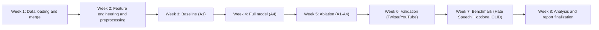

# Project Planning Video - 5 Slide Content (Document Version)

Use this as your script + slide text source.  
Target total duration: **<= 5:00** (about 50-60 seconds per slide).

---

## Slide 1 - Introduction, Problem, Significance, Motivation

### Slide title
**Intelligent Model for Cyberbullying Detection and Intervention**

### On-slide bullets
- Cyberbullying is not just offensive text; it involves **repetition**, **peer relationships**, and behavioural context.
- Existing text-only systems often misclassify harmful vs non-harmful language.
- Motivation: build a model that combines text with relational/behavioural signals.
- Research question: *What is the contribution of peerness and repetition compared with text-only detection?*

### Speaker notes (short)
Introduce the project domain, why it matters, and the core research question. Emphasize this is both a detection and intervention-oriented project.

---

## Slide 2 - Preparation Work + Good Literature Review + Feasibility

### Slide title
**Preparation Work and Evidence of Feasibility**

### On-slide bullets
- Completed: project structure, data loaders, preprocessing and feature modules, EDA notebook.
- Literature review completed on:
  - text models (TF-IDF/XGBoost, CNN/LSTM),
  - multi-modal pipelines,
  - intervention approaches,
  - dataset and evaluation limitations.
- Key feasibility evidence: merged dataset pipeline and class-distribution checks already implemented.
- Validation strategy prepared to avoid leakage and improve realism.

### Visual suggestion
Insert your **EDA output screenshot** (`outputs/media/eda_output_screenshot.png`).

### Speaker notes (short)
Show that groundwork is done, methods are justified from literature, and project execution is technically feasible next semester.

---

## Slide 3 - Research Gap and Proposed Contribution

### Slide title
**Research Gap and Proposed Contribution**

### On-slide bullets
- **Gap 1:** many studies optimize text-only performance and ignore repeated user interaction context.
- **Gap 2:** weak cross-platform generalization evidence (single-source evaluation).
- **Gap 3:** intervention needs are discussed, but often not operationalized in model features.
- **Contribution:** evaluate text + relational/behavioural features through controlled ablation (A1-A4), independent validation, and benchmark comparison.

### Speaker notes (short)
State clearly what gap you found at the end of your review and exactly how your project addresses it.

---

## Slide 4 - Implementation Plan + Gantt + Risks/Mitigation

### Slide title
**Implementation Plan, Timeline, and Risk Controls**

### On-slide bullets
- Workflow: Data -> Features -> Baseline -> Full Model -> Ablation -> Validation -> Benchmark -> Reporting.
- Risks are quantified and managed:
  - leakage risk,
  - class imbalance,
  - runtime constraints,
  - schedule delays.
- Each risk has mitigation and fallback path (contingency).

### Gantt diagram (Mermaid)

### Speaker notes (short)
Walk through dependencies and make clear that if one step slips, there is a fallback strategy (e.g., prioritize baseline + ablation before optional benchmark).

---

## Slide 5 - Evaluation Criteria + PLESI + Potential Impact

### Slide title
**Evaluation, PLESI, and Potential Impact**

### On-slide bullets
- Evaluation criteria:
  - precision, recall, F1, ROC-AUC, confusion matrix,
  - ablation comparison A1-A4,
  - cross-dataset validation and benchmark performance.
- PLESI covered:
  - Professional reproducibility,
  - Legal data-use/IP compliance,
  - Ethical fairness/privacy and false-positive risk,
  - Social implications for users and moderators.
- **Potential impact (end of project):**
  - better prioritization for moderation teams,
  - improved identification of repeat harmful interactions,
  - stronger evidence for safer, context-aware intervention design.

### Speaker notes (short)
End with what changes if the project succeeds: better, more responsible moderation support rather than text-only flagging.

---

## Quick Delivery Checklist (before recording)

- Keep to **<= 5:00** total.
- Use readable text (24 pt+), high contrast.
- Ensure audio is clear and paced.
- Do not show personal or sensitive data.
- Export as MP4 (H.264), then submit to Canvas.

