<!-- front:title-page -->

# Heriot-Watt University

# Masters Thesis

# Intelligent Model for Cyberbullying Detection and Intervention

**Author:** Pedakamsetti Harshitha Lakshmi

**Supervisor:** Dr. Heba Elshimy

A thesis submitted in fulfilment of the requirements for the degree of **MSc Artificial Intelligence** in the **School of Mathematical and Computer Sciences**

**August 2026**

<!-- front:declaration-form -->

## Student Declaration of Authorship

| Field | Value |
|-------|-------|
| Course code and name | F21MP – Masters Project and Dissertation |
| Type of assessment | Individual |
| Coursework Title | INTELLIGENT MODEL FOR CYBERBULLYING DETECTION AND INTERVENTION |
| Student name | Pedakamsetti Harshitha Lakshmi |
| Student ID | H00514683 |

By signing this form:

- I declare that the work I have submitted for individual assessment is entirely my own. I have NOT taken the ideas, writings or inventions of another person and used these as if they were my own. My submission is expressed in my own words. Any uses made within this work of the ideas, writings or inventions of others, or of any existing sources of information (books, journals, websites, etc.) are properly acknowledged and listed in the references and/or acknowledgements section.
- I confirm that I have read, understood and followed the University's Regulations on plagiarism as published on the University's website, and that I am aware of the penalties that I will face should I not adhere to the University Regulations.
- I confirm that I have read, understood and avoided the different types of plagiarism explained in the University guidance on Academic Integrity and Plagiarism.

**Student Signature:** Pedakamsetti Harshitha Lakshmi  
**Date:** August 2026

<!-- front:declaration-narrative -->

## Declaration of Authorship

I, Pedakamsetti Harshitha Lakshmi, declare that this thesis titled *Intelligent Model for Cyberbullying Detection and Intervention* and the work presented in it is my own. I confirm that this work submitted for assessment is my own and is expressed in my own words. Any uses made within it of the works of other authors in any form (e.g., ideas, equations, figures, text, tables, programs) are properly acknowledged at any point of their use. A list of the references employed is included.

**Signed:** Pedakamsetti Harshitha Lakshmi  
**Date:** August 2026

*Both the structured declaration form and this narrative declaration satisfy Heriot-Watt University authorship requirements for F21MP submission.*

<!-- front:quote -->

"Technology should improve lives, not become a weapon to harm others."
UNESCO
Behind the numbers: ending school violence and bullying (2019)

<!-- front:abstract -->

## Abstract

Automated cyberbullying detection often relies on message text alone, yet harmful online behaviour is characterised by repeated, targeted interactions between peers—not isolated wording. Text-only systems struggle when labels depend on who is involved and how often aggression occurs, and when offensive language is conflated with targeted harm.

This dissertation designs and evaluates a multi-dimensional detection approach that combines text classification with relational signals (peerness) and behavioural signals (repetition). A structured ablation study (models A1–A4) quantifies the contribution of each feature group on the Towards Comprehensive corpus.

The implementation uses term frequency–inverse document frequency text features with gradient-boosted trees, pair-aware stratified splitting to avoid leakage, and class-weighted training under severe label imbalance. Derived indicators support intervention-oriented prioritisation for moderator workflows.

Cross-dataset validation on independent Twitter and YouTube subsets assesses generalisation with explicit exclusion of overlapping corpora. External benchmarking on established hate-speech and offensive-language datasets situates the pipeline within prior harmful-language research.

Results show that relational features provide decisive in-domain signal when interaction metadata is available, while text-only models require domain-aligned retraining for deployment on new platforms. The work supports transparent, human-in-the-loop moderation rather than autonomous enforcement.

<!-- front:acknowledgements -->

## Acknowledgements

I would like to thank my supervisor, Dr. Heba Elshimy, for her guidance, feedback, and support throughout this project. Her advice on methodology, evaluation design, and academic writing has been invaluable.

I am grateful to the authors and maintainers of the public datasets used in this research, including the Towards Comprehensive, Cyberbullying, Automated Hate Speech, and OLID corpora, without which this work would not have been possible.

Finally, I thank my family and friends for their encouragement during the MSc programme.

<!-- front:abbreviations -->

## Abbreviations

AI Artificial Intelligence
API Application Programming Interface
AUC Area Under the Receiver Operating Characteristic Curve
CB Cyberbullying
CNN Convolutional Neural Network
CSV Comma-Separated Values
EDA Exploratory Data Analysis
F1 F1-score (harmonic mean of precision and recall)
GDPR General Data Protection Regulation
GPU Graphics Processing Unit
JSON JavaScript Object Notation
LogReg Logistic Regression
LSTM Long Short-Term Memory
ML Machine Learning
MoSCoW Must have, Should have, Could have, Won't have
NLP Natural Language Processing
OLID Offensive Language Identification Dataset
PLES Professional, Legal, Ethical and Societal (issues)
REST Representational State Transfer
ROC Receiver Operating Characteristic
ROC-AUC Receiver Operating Characteristic–Area Under the Curve
SemEval Semantic Evaluation
SQL Structured Query Language
SVD Singular Value Decomposition
TF-IDF Term Frequency–Inverse Document Frequency
TIVA Text, Images, Video, Audio
UI User Interface
URL Uniform Resource Locator
XGBoost Extreme Gradient Boosting

<!-- chapter:1 -->

## 1 Introduction

### 1.1 Background and Motivation

Cyberbullying is widely defined as repeated, targeted harm between peers, with intent to cause distress [1]. It involves relational context (**peerness**) and behavioural patterns (**repetition**, via aggression ratios at pair level), not isolated messages. Text-only detection often fails because the same words can be harmless or harmful depending on context [3]; conflating offensive language with hate speech reduces precision. Models must therefore combine linguistic, relational, and behavioural signals.

Harmful-language detection is also sensitive to label definitions, dataset bias, and evaluation design [14, 15]. Cyberbullying requires repeated-interaction and relationship context to prioritise moderation cases [1, 7]. This motivates comparative ablation (A1–A4) and leakage-aware cross-dataset validation rather than a single in-sample accuracy figure.

This research adopts a holistic approach using derived indicators (aggression_ratio, combined_score) for intervention-oriented analysis. Validation uses only independent Twitter and YouTube subsets to avoid corpus overlap [2]; benchmarks draw on Davidson et al. [3, 4] and OLID [5]. All data are public; no primary collection is conducted.

### 1.2 Aim

The aim of this project is to design and evaluate an intelligent cyberbullying detection approach that goes beyond text-only classification by incorporating relational and behavioural dimensions, in order to improve detection quality and support intervention-oriented decision making.

### 1.3 Objectives

To achieve this aim, the project has five main objectives:

1. Develop a multi-dimensional detection model that integrates text-based NLP with relational and behavioural features.
2. Quantify the specific contribution of each feature through a structured ablation study: A1 (text-only), A2 (text+peerness), A3 (text+repetition), and A4 (full model).
3. Evaluate model generalisability on independent external data while strictly avoiding overlapping sources that could cause leakage.
4. Benchmark performance against established offensive-language and hate-speech classification corpora.
5. Assess practical intervention implications, focusing on how relational features support moderator decisions and repeat-offender identification.

### 1.4 Research Question

The main question the project addresses is:

> What contribution do relational and behavioural features (peerness, repetition) make to cyberbullying detection compared with text-only approaches?

This is answered by training and evaluating four model variants (A1–A4), validating on Twitter and YouTube, and benchmarking on external datasets, as set out in Chapters 3–6.

**Hypothesis.** The central hypothesis is that peerness and repetition provide complementary signal beyond message text for cyberbullying detection on Towards Comprehensive, and that their contribution can be quantified through controlled ablation. A secondary expectation is that text-only models will generalise poorly across platforms without adaptation when label definitions and positive rates differ.

### 1.5 Document Structure Outline

The study is structured into five further chapters as follows:

Chapter 2: Provides the background of automated cyberbullying detection and harmful-language classification, with a focus on relational and behavioural signals alongside text. It also reviews related works and identifies gaps in the current literature with regard to the problem.

Chapter 3: Describes the methodology, including model development, data sources, leakage-aware validation design, and the evaluation strategy.

Chapter 4: Presents the implementation of the detection pipeline and a proof-of-concept moderator dashboard (§4.7), including feature engineering, training, and intervention outputs; supplementary code and validation implementation are in Appendix D.

Chapter 5: Describes the datasets and preparation methods, outlines experimental setups, reports quantitative results, and critically analyses findings in relation to the research objectives and prior work.

Chapter 6: Summarises the principal findings, states the contributions and limitations of the work, and outlines directions for future research.

Four appendices supplement the main chapters. Appendix A documents project management, including the work plan, risk analysis, and professional, legal, ethical and societal (PLES) considerations. Appendix B provides requirements analysis mapped to the evaluation programme. Appendix C lists reproducibility details (software environment and result artefacts). Appendix D holds supplementary implementation code, API specification, evaluation discussion tables, and figures not central to the main narrative.

### 1.6 Expected Contributions and Scope

This dissertation makes five substantive contributions to the cyberbullying-detection literature:

1. **Empirical quantification of relational features** — A structured ablation (A1–A4) isolates the marginal effect of peerness and repetition on in-domain F1, addressing a gap identified in Ejaz et al. [1] where relational fields exist but per-feature contribution is not reported.
2. **Leakage-aware cross-dataset validation** — External evaluation uses only Twitter and YouTube subsets [2], with explicit exclusion of Wikipedia-overlapping files [10], so reported generalisation metrics are not inflated by shared training text.
3. **Reproducible multi-phase pipeline** — A modular phase-based implementation with pair-aware splitting, fixed hyperparameters for fair ablation, and JSON/CSV artefact logging supports replication and extension.
4. **Intervention-oriented derived features** — `aggression_ratio`, `is_repeat_offender`, and `combined_score` operationalise repeat-offender and high-risk pair prioritisation for moderator workflows [7].
5. **Moderator dashboard prototype** — A local human-in-the-loop browser interface demonstrates the three-tier review workflow from §4.6 without production deployment (§4.7).

**Scope boundaries.** The work is limited to English text and tabular relational features from Towards Comprehensive; multi-modal detection [6, 8], live platform integration, transformer fine-tuning, and primary data collection are out of scope and documented as limitations in Chapter 6.

<!-- chapter:2 -->

## 2 Literature Review

This chapter provides background on automated cyberbullying detection, reviews related works in a structured manner (following the approach used in comparable MSc dissertations), and presents a critical analysis of gaps addressed by the present study. The review draws on references [1]–[15].

### 2.1 Background

Cyberbullying has serious psychological, social, and academic effects, especially for adolescents [1, 7]. It is widely defined as repeated, targeted harm between peers with intent to cause distress—not as a single offensive message in isolation. Automated detection can support platform moderators, educators, and early intervention systems, but most deployed approaches rely heavily on text alone: keywords, lexicons, or NLP classifiers [6, 9, 13].

Harmful-language detection is further complicated because abusive phenomena are heterogeneous, context-dependent, and sensitive to annotation choices [14, 15]. The same surface wording can be harmless banter or targeted harm depending on who is involved, how often messages occur, and the relationship between users. Text-only models therefore struggle when labels correlate more strongly with relational and behavioural patterns than with distinctive vocabulary—a limitation this dissertation addresses through peerness and repetition features [1].

From a modelling perspective, gradient-boosting and deep-learning classifiers are widely used for text. TF-IDF with XGBoost offers an interpretable, efficient baseline on sparse text features and handles class imbalance via `scale_pos_weight` [6, 9]. Deep models (convolutional neural networks (CNNs), long short-term memory (LSTM) networks) can capture phrase-level and sequential patterns but require larger labelled corpora and offer weaker interpretability for moderators. Evaluation under imbalance should prioritise precision, recall, F1, and receiver operating characteristic–area under the curve (ROC-AUC) rather than accuracy alone [3, 15]. This dissertation adopts TF-IDF + XGBoost as the core architecture and evaluates relational feature contributions through structured ablation (A1–A4).

#### 2.1.1 Technical foundations

**Term frequency–inverse document frequency (TF-IDF).** Each message is represented as a sparse vector over a vocabulary of terms (unigrams and bigrams). Term frequency is down-weighted for terms that appear in many documents (`sublinear_tf=True`), and rare terms are excluded (`min_df=2`). The maximum vocabulary size is capped at 10,000 features to limit dimensionality on a corpus of ~15.5k messages.

**Extreme gradient boosting (XGBoost).** A gradient-boosted ensemble of decision trees learns a non-linear decision boundary over the concatenated text and tabular feature vector. Class imbalance is handled by `scale_pos_weight`, which up-weights the positive class during training so the model does not collapse to predicting all negatives—a common failure mode when positives comprise less than 1% of labels.

**Evaluation metrics.** Under severe imbalance, accuracy is misleading: a classifier predicting all negatives achieves ~99% accuracy while detecting zero cyberbullying cases. This project therefore reports **precision** (of flagged messages, how many are true positives), **recall** (of true cyberbullying cases, how many are detected), **F1-score** (harmonic mean of precision and recall), and **ROC-AUC** (ranking quality independent of classification threshold). Confusion matrices are reported per experiment to expose false-positive and false-negative trade-offs relevant to moderator deployment [14].

### 2.2 Related Works

This section reviews prior studies most relevant to the present work. Each subsection summarises the contribution of a key paper, its methods and findings, and its relationship to this dissertation.

#### 2.2.1 Towards Comprehensive Cyberbullying Detection (Ejaz et al.)

Ejaz et al. [1] introduce the Towards Comprehensive Cyberbullying Detection dataset, designed to move beyond message text alone by incorporating four dimensions: aggressive text, repetition, peerness, and intent to harm. The corpus contains approximately 15,554 messages exchanged between synthetic user pairs, with binary cyberbullying labels and pair-level relational fields (Peerness, TotalMsgs, AggressiveMsgs). The authors recommend derived indicators such as aggression_ratio and combined relational scores to capture repeated harmful interaction patterns.

![Figure 2.1: Ejaz et al. comprehensive cyberbullying framework Ejaz et al. [1]](../../outputs/media/related_work_ejaz_framework.png)

This dataset is the primary training source for the present dissertation. Unlike text-only corpora, it enables ablation experiments that isolate the contribution of peerness and repetition. The severe class imbalance (126 positives, 0.81%) also motivates imbalance-aware metrics and pair-aware splitting rather than naive random message-level splits. The present work extends Ejaz et al. by implementing and quantifying models A1–A4 and evaluating generalisation on independent Twitter and YouTube subsets.

#### 2.2.2 Automatic Detection of Cyberbullying in Social Media Text (Van Hee et al.)

Van Hee et al. [13] present one of the earlier large-scale studies on automatic cyberbullying detection in social media text, using a hybrid approach that combines lexical resources with machine learning (ML) classifiers. Their work established that cyberbullying detection requires more than keyword matching because harmful intent is often implicit and context-dependent. They report moderate performance with traditional NLP features and highlight the difficulty of generalising across platforms and annotation schemes.

![Figure 2.2: Van Hee et al. text-based cyberbullying detection pipeline Van Hee et al. [13]](../../outputs/media/related_work_vanhee_pipeline.png)

This study informs the text-only baseline (A1) in the present dissertation. Van Hee et al. focus on message-level text; they do not model user-pair repetition or peerness explicitly. The present work therefore treats their line of research as a foundation for text classification while addressing relational gaps through Towards Comprehensive features.

#### 2.2.3 Automated Hate Speech Detection and the Problem of Offensive Language (Davidson et al.)

Davidson et al. [3] argue that conflating offensive language with hate speech leads to poor precision and misleading evaluation. They introduce a three-way taxonomy—hate speech, offensive language, and neither—and release a crowd-sourced labelled Twitter corpus of approximately 24.8k tweets [4]. Their experiments show that multi-class separation improves precision over binary or lexicon-only baselines and that annotation granularity materially affects reported performance.

![Figure 2.3: Davidson et al. three-class hate speech detection pipeline Davidson et al. [3]](../../outputs/media/related_work_davidson_pipeline.png)

This dissertation uses the Davidson corpus for external hate-speech benchmarking (three-class hate/offensive/neither). Davidson et al. report that separating hate speech from offensive language improves precision over binary baselines [3, 4]; Chapter 5 compares the implemented pipeline against that corpus. Their work also motivates careful interpretation of false positives during cross-dataset validation, where offensive Twitter language may be flagged under a cyberbullying label trained on a different annotation scheme.

#### 2.2.4 Large Scale Crowdsourcing and Characterization of Twitter Abusive Behavior (Founta et al.)

Founta et al. [14] conduct a large-scale crowdsourced study of abusive behaviour on Twitter, demonstrating that "abuse" is not a single homogeneous category. They characterise multiple abuse types and show that dataset construction, annotator bias, and class definitions substantially influence classifier behaviour and reported metrics. Their work emphasises robust evaluation protocols and transparent reporting rather than single accuracy figures.

This dissertation adopts Founta et al.'s caution in evaluation design: reporting precision, recall, F1, ROC-AUC, and confusion matrices per phase; using ablation to attribute performance to specific features; and interpreting cross-domain drops as domain shift rather than model failure alone. Founta et al. do not provide relational cyberbullying features; their contribution is methodological rigour for abusive-language evaluation.

#### 2.2.5 Ex Machina: Personal Attacks Seen at Scale (Wulczyn et al.)

Wulczyn et al. [10] study personal attacks in Wikipedia talk-page comments at scale, using crowd-sourced labels and linear models over n-gram features. Their dataset underlies parts of the publicly available Cyberbullying Dataset on Kaggle [2]. A critical finding for validation design is that Wikipedia-derived text reappears across multiple files; using overlapping subsets for training and testing causes data leakage and inflated generalisation estimates.

![Figure 2.4: Leakage-aware validation design (Wulczyn et al.) Wulczyn et al. [10]](../../outputs/media/related_work_wulczyn_validation.png)

This dissertation explicitly excludes aggression, attack, and toxicity files from external validation for this reason. Only independent Twitter and YouTube subsets are used in Phase 2. Wulczyn et al. thus inform both the choice of validation corpora and the leakage-control rules applied in Chapters 3 and 4.

#### 2.2.6 A Survey on Automatic Detection of Hate Speech in Text (Fortuna and Nunes)

Fortuna and Nunes [15] provide a comprehensive survey of hate-speech detection methods, datasets, and evaluation practices. They categorise approaches by feature type (lexical, embedding-based, deep learning), highlight the impact of label taxonomy and dataset bias on results, and discuss open challenges including cross-lingual generalisation, explainability, and adversarial language evolution.

The survey supports the present dissertation's emphasis on comparative evaluation and benchmark alignment. It also justifies the choice of OLID [5] and Davidson [3, 4] as external references while noting that hate-speech and cyberbullying tasks are related but not identical—an important distinction when interpreting zero-shot cross-dataset results.

#### 2.2.7 Predicting the Type and Target of Offensive Posts — OLID (Zampieri et al.)

Zampieri et al. [5] introduce the Offensive Language Identification Dataset (OLID) as part of Semantic Evaluation (SemEval)-2019 Task 6, with hierarchical labels at Level A (offensive vs. non-offensive), Level B (targeted vs. untargeted), and Level C (target type). Level A provides a standard binary offensive-language benchmark used widely in subsequent research.

![Figure 2.5: OLID hierarchical offensive language labelling tasks Zampieri et al. [5]](../../outputs/media/related_work_olid_hierarchy.png)

This dissertation includes the Offensive Language Identification Dataset Level A as an optional external benchmark, complementing Davidson et al. by offering a second established offensive-language reference corpus [5]. Empirical results on this benchmark are reported in Section 5.3.4.

#### 2.2.8 Cyberbullying Detection and Prevention Using AI (Manju Sri et al.)

Manju Sri et al. [6] propose a cyberbullying detection and prevention system combining text analysis with image classification. The text branch uses XGBoost with TF-IDF or embedding features; the image branch applies InceptionV3 [11] to detect offensive gestures, hate symbols, and explicit visual content. The authors report improved detection when modalities are combined but note increased computational cost and deployment complexity.

This work aligns with the present dissertation's choice of TF-IDF + XGBoost for the text pathway. Manju Sri et al. focus on multi-modal fusion rather than relational user-pair features; their image branch is out of scope here but informs future multi-modal extensions discussed in Chapter 6.

#### 2.2.9 Machine Learning Approaches for Detection of Cyberbullying in Virtual Space (Vinodha et al.)

Vinodha et al. [7] review machine-learning approaches for cyberbullying detection in virtual environments and discuss intervention mechanisms, including cognitive AI chatbots that provide theory-based support for victims aged 8–16. They emphasise that detection should connect to actionable response—alerts, counselling pathways, and escalation workflows—rather than classification alone.

This dissertation operationalises intervention relevance through derived features (`is_repeat_offender`, `combined_score`) and discusses moderator prioritisation in Sections 5.4 and 6.2. Vinodha et al. motivate the social purpose of the system but do not provide empirical ablation of relational features; the present work quantifies that gap experimentally.

#### 2.2.10 Multi-modal Approach to Detect Cyberbullying — TIVA (Jaiswal and Attri)

Jaiswal and Attri [8] propose the Text, Images, Video, Audio (TIVA) framework for cyberbullying detection across multiple file formats. Each modality contributes complementary evidence; fusion improves robustness when one channel is ambiguous. The study reports empirical gains on multi-format corpora but requires substantial preprocessing and labelled multi-modal data.

TIVA represents the state of the art in multi-modal cyberbullying detection. The present dissertation deliberately scopes to text plus relational tabular features because Towards Comprehensive does not provide image, video, or audio fields. Jaiswal and Attri inform future work rather than the core implementation.

#### 2.2.11 Cyberbullying Detection NLP Pipeline (Mandala)

Mandala [9] documents an end-to-end NLP pipeline for cyberbullying detection on Kaggle, covering text cleaning, vectorisation (TF-IDF or embeddings), and classifier training. The notebook-style workflow demonstrates practical preprocessing steps—lowercasing, tokenisation, and feature extraction—that align with standard NLP practice for social-text classification.

This pipeline informed the preprocessing and TF-IDF design in the shared utilities module. Mandala's work is text-only and educational in nature; it does not address peerness, repetition, or leakage-aware cross-dataset validation. The present dissertation extends this line of work with structured ablation and external benchmarking.

#### 2.2.12 Reviews and Comparative Summary

The following comparative summary collates cyberbullying (CB) detection approaches from the literature reviewed in Section 2.2.

**Table 2.1: Comparative summary of related works**

| Reference | Primary focus | Features used | Relational / behavioural signals | Key limitation relative to this dissertation |
|-----------|---------------|---------------|----------------------------------|---------------------------------------------|
| Ejaz et al. [1] | Comprehensive CB dataset | Text + peerness + repetition | Yes (dataset provides fields) | No published ablation quantifying each feature |
| Van Hee et al. [13] | Social-media CB detection | Lexical + ML text features | No | Message-level text only |
| Davidson et al. [3, 4] | Hate vs offensive language | Text (TF-IDF, n-grams) | No | Different task (hate speech, not CB pairs) |
| Founta et al. [14] | Twitter abuse characterisation | Text; multi-type labels | No | Evaluation methodology, not CB modelling |
| Wulczyn et al. [10] | Personal attacks (Wikipedia) | N-gram text features | No | Same text source as training data—leakage risk |
| Fortuna and Nunes [15] | Hate-speech survey | Review of methods | No | Conceptual; no relational CB experiments |
| Zampieri et al. [5] | OLID offensive language | Text | No | Offensive language, not cyberbullying pairs |
| Manju Sri et al. [6] | CB detection + prevention | Text + images | No | Multi-modal cost; no peerness/repetition |
| Vinodha et al. [7] | ML + intervention in virtual spaces | Text (review) | Discussed, not modelled | No empirical feature ablation |
| Jaiswal and Attri [8] | TIVA multi-modal CB | Text + image + video + audio | No | Requires multi-modal labelled data |
| Mandala [9] | NLP pipeline (Kaggle) | Text (TF-IDF) | No | Text-only baseline tutorial |

Across these works, three gaps motivate the present dissertation: (1) few studies quantify the marginal contribution of relational features through ablation; (2) cross-platform evaluation often ignores data overlap and leakage; (3) intervention relevance is discussed conceptually but weakly operationalised in model design. This research addresses all three through models A1–A4, Twitter/YouTube-only validation, and derived intervention indicators.

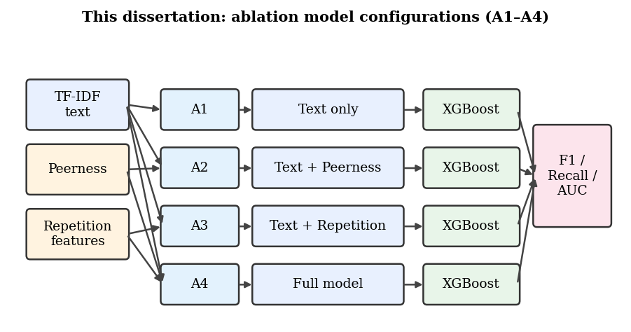

### 2.3 Critical Analysis

**Datasets used in this research.** Table 2.2 summarises the public corpora employed in this study.

**Table 2.2: Datasets used in this research**

| Dataset | Source | Use in Project |
|---------|--------|----------------|
| Towards Comprehensive [1] | Mendeley Data (DOI: 10.17632/wmx9jj2htd.1). ~15.6k messages, user pairs, peerness, TotalMsgs, AggressiveMsgs. | Training (Phase 1). Merge Dataset.csv + Repetition.csv on (User1, User2). |
| Cyberbullying Dataset [2] | Kaggle (Shahane). twitter, twitter_racism, twitter_sexism, youtube; aggression/attack/toxicity overlap—exclude. | Validation (Phase 2): Twitter and YouTube only. |
| Automated Hate Speech [3, 4] | Davidson et al., GitHub. ~24.8k tweets; class 0=hate, 1=offensive, 2=neither. | Benchmark (Phase 3). |
| OLID [5] | SemEval-2019. Level A: offensive vs non-offensive. | Optional benchmark. |

A significant challenge across these datasets is class imbalance. The YouTube subset is smaller than the Twitter subsets, and Automated Hate Speech labels are skewed toward offensive language. Training uses stratified splits and class-weighting via `scale_pos_weight` in XGBoost.

**Critical assessment.** (i) Text-based detection benefits from models like XGBoost [6, 9] and from clear separation of hate speech vs offensive language [3]; (ii) Ejaz et al. [1] demonstrate that relational and behavioural information can support cyberbullying modelling, but prior work has not fully quantified each feature's contribution; (iii) isolating the training set from Twitter/YouTube validation—following leakage lessons from Wulczyn et al. [10]—ensures generalisation metrics reflect independent data; (iv) ablation studies (A1–A4) are the appropriate method to quantify peerness and repetition contributions, extending the related works reviewed in Section 2.2.

**Research gap and contribution positioning.** Three recurring gaps are most relevant: (1) many studies optimise text-only classification without modelling repeated interactions between user pairs [13, 9]; (2) evaluation on single-source or overlapping data makes cross-platform generalisation unclear [14, 10]; (3) intervention relevance is discussed conceptually [7] but weakly operationalised in model features. This dissertation addresses these through relational features, leakage-aware validation, intervention-oriented indicators, and benchmark comparison against Davidson et al. [3] and Zampieri et al. [5].

**Table 2.3: Positioning of this dissertation against prior empirical results**

| Prior study | Task / dataset | Published or reported baseline | This dissertation (comparable setup) | Distinction |
|-------------|------------------|-------------------------------|--------------------------------------|-------------|
| Ejaz et al. [1] | CB on Towards Comprehensive | Framework + relational fields; no ablation table | A4 F1 = 0.980; A1→A2 +0.645 F1 | First controlled ablation of peerness vs repetition |
| Van Hee et al. [13] | Social-media CB (text) | Moderate text-only performance | A1 F1 = 0.000 on Towards Comprehensive | Shows text-only insufficiency when labels are relational |
| Davidson et al. [3, 4] | 3-class hate/offensive/neither | TF-IDF + LogReg baselines on Twitter | macro-F1 = 0.656–0.740 (TF-IDF + LogReg/XGBoost) | Same corpus; confirms architecture validity on hate speech |
| Wulczyn et al. [10] | Personal attacks (Wikipedia) | N-gram linear models | Validation excludes Wikipedia-overlap files | Leakage-aware external validation design |
| Zampieri et al. [5] | OLID Level A (offensive language) | SemEval-2019 task baselines | Zero-shot F1 = 0.000; in-domain F1 = 0.608 | Quantifies domain shift across related tasks |
| Manju Sri et al. [6] | Multi-modal CB | XGBoost on text branch | TF-IDF + XGBoost text pathway (A1–A4) | Text + relational tabular instead of text + image |
| Mandala [9] | Kaggle NLP pipeline | Text-only TF-IDF workflow | Extended with pair-aware split + ablation | Educational pipeline → research-grade evaluation |

This table does not claim superiority over every prior baseline; rather, it situates the present results within the literature reviewed in Section 2.2. The principal novelty lies in ablation of relational features on Towards Comprehensive and in leakage-controlled cross-platform validation, not in beating state-of-the-art hate-speech leaderboards.

<!-- chapter:3 -->

## 3 Methodology

This chapter describes the methodological approach: an overview of the development pipeline and experimental programme, followed by a detailed process description covering data, model design, evaluation strategy, and quality controls. Requirements are documented in Appendix B.

### 3.1 Overview

The project follows a five-stage development pipeline from public dataset acquisition through to evaluation and reporting (Figure 3.1). Four experimental phases are executed within this pipeline (Figure 3.2): in-domain training, cross-dataset validation, ablation with hate-speech benchmarking, and optional OLID benchmarking.

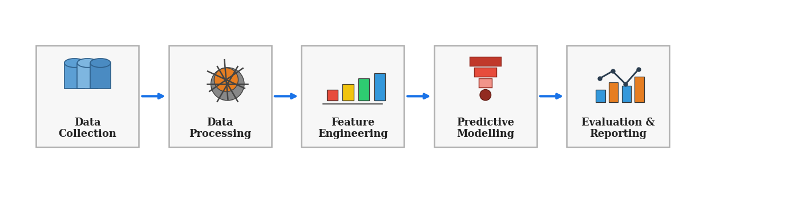

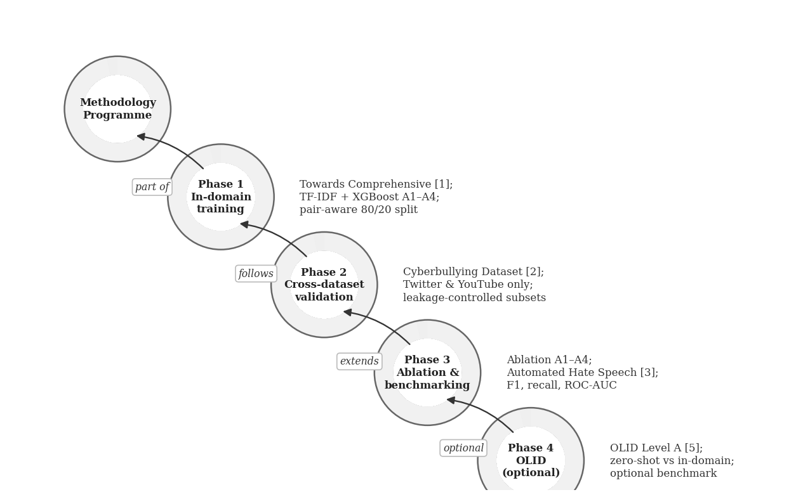

The methodology addresses the research question by (i) building models A1–A4 on Towards Comprehensive [1], (ii) validating on independent Twitter and YouTube subsets [2] with leakage controls [10], and (iii) benchmarking against established hate-speech and offensive-language corpora [3, 5].

### 3.2 Process Description

#### 3.2.1 Key Terms and Definitions

**Table 3.1: Key terms used in this dissertation**

| Term | Definition |
|------|------------|
| Peerness | Pair-level score (0–1) from Towards Comprehensive indicating relational closeness between User1 and User2 |
| Repetition | Pair-level behavioural signals: `TotalMsgs`, `AggressiveMsgs`, and derived `aggression_ratio` |
| Pair-aware split | Train/test partition at (User1, User2) level so no conversation pair appears in both sets |
| Cyberbullying label (`CBLabel`) | Binary message-level label (1 = cyberbullying, 0 = not) in Towards Comprehensive |
| Zero-shot evaluation | Applying a model trained on one corpus directly to another without target-domain retraining |
| Domain adaptation | Re-fitting the text-only model on a small labelled slice of the target platform before testing |

#### 3.2.2 Data Collection

No primary data collection is carried out. The project uses existing, publicly available datasets [1–5, 10]. The core training source is Towards Comprehensive [1], where message-level records are merged with relational records using (User1, User2) to attach peerness and repetition signals. For external validation, the Cyberbullying dataset [2] is used with independent Twitter and YouTube subsets only. For benchmarking, Automated Hate Speech [3, 4] is used as a 3-class task, and OLID [5] is included as an optional binary benchmark.

#### 3.2.3 Datasets and Overlap

Figure 3.3 shows the hierarchical relationship between the public corpora used in this research: one training source, independent validation subsets, and external benchmark datasets.

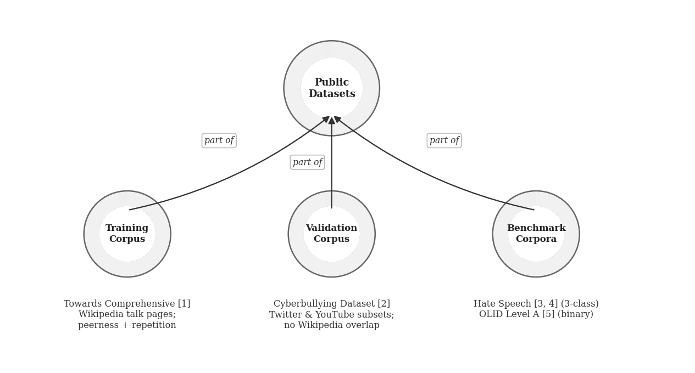

Towards Comprehensive and parts of the Cyberbullying Dataset share the same text source (Elsafoury / Wikipedia talk corpus). The aggression, attack, and toxicity files contain the same underlying text as the training data; using them for validation would cause **data leakage**.

**Leakage illustration:** Manual inspection confirms that identical Wikipedia talk-page messages appear in both Towards Comprehensive (`Dataset.csv`) and in the aggression, attack, and toxicity parsed files from the Cyberbullying Dataset [2, 10]. For example, a message beginning *"Stop being an a****** and suggesting unwarranted punishments…"* is present in both sources. Such overlap would inflate validation scores if overlapping files were used for testing.

**Table 3.2: Cyberbullying dataset files and validation eligibility**

| File in Cyberbullying Dataset | Overlap? | Use for validation? |
|------------------------------|----------|---------------------|
| aggression_parsed_dataset.csv | Yes | **No** |
| attack_parsed_dataset.csv | Yes | **No** |
| toxicity_parsed_dataset.csv | Yes | **No** |
| twitter_parsed_dataset.csv | No | **Yes** |
| twitter_racism_parsed_dataset.csv | No | **Yes** |
| twitter_sexism_parsed_dataset.csv | No | **Yes** |
| youtube_parsed_dataset.csv | No | **Yes** |

#### 3.2.4 Model Design

The primary model combines text features (TF-IDF), peerness (0–1 score), and repetition (TotalMsgs, AggressiveMsgs, aggression_ratio). Training uses merged Towards Comprehensive data. A pair-aware stratified train/test split (80/20) ensures no (User1, User2) pair appears in both train and test. Four ablation configurations (A1–A4) isolate feature contributions; configuration A5 adds demographic features as a sensitivity check. A text-only baseline (A1) supports comparison.

**Table 3.3: Ablation model configurations and feature sets**

| Model | Text (TF-IDF) | Peerness | Repetition fields | Derived features | Demographics |
|-------|:-------------:|:--------:|:-----------------:|:----------------:|:------------:|
| A1 | ✓ | — | — | — | — |
| A2 | ✓ | ✓ | — | — | — |
| A3 | ✓ | — | ✓ (TotalMsgs, AggressiveMsgs, aggression_ratio) | is_repeat_offender | — |
| A4 | ✓ | ✓ | ✓ | aggression_ratio, is_repeat_offender, combined_score | — |
| A5 | ✓ | ✓ | ✓ | (as A4) | age, gender, age_diff |

Pair-aware splitting operates at the **(User1, User2)** level: all messages belonging to a conversation pair are assigned entirely to train or test. This prevents the model from memorising pair-specific relational patterns in training and then being evaluated on the same pairs—a form of leakage distinct from shared message text [1]. Stratification on pair-level `CBLabel` preserves the rare positive rate in both partitions.

#### 3.2.5 Evaluation Strategy

**Ablation studies:** A1 text only; A2 text + peerness; A3 text + repetition; A4 full model. Results reported in a single comparison table (Objective 2).

**Metrics:** Accuracy, precision, recall, F1 (primary under imbalance), ROC-AUC, confusion matrix. Precision and recall are computed on the positive (cyberbullying) class unless otherwise stated; hate-speech benchmarking reports macro-F1 across three classes.

**Validation (R3, R6):** Two strategies on Twitter/YouTube: (1) text-only pathway (A1) — the trained model is applied without retraining; (2) default-value pathway (A4 with placeholder tabular values) — demonstrates that relational features cannot be imputed on external platforms. Additional Phase 2 experiments include: **threshold sweep** (varying decision threshold on validation probabilities to maximise F1); **domain-adaptive fine-tuning** (re-fitting the text-only model on 20% of target-domain labels, testing on the remaining 80%); **embedding extension** (TF-IDF → singular value decomposition (SVD) → LogReg on reduced dimensions); and a **3-seed robustness check** reporting mean, standard deviation, and 95% confidence interval for adaptation F1.

**Benchmarking (Objective 4):** Davidson et al.'s 3-class hate-speech corpus [3, 4] and an optional Offensive Language Identification Dataset Level A benchmark [5] (offensive vs. not offensive). The latter is not used for cyberbullying validation (R3/R6); implementation is in Appendix D (§D.2) and results in §5.3.4.

A drop in validation performance relative to in-domain results is expected and interpreted as domain shift [3, 10].

#### 3.2.6 Implementation Plan

1. Data: Load and merge Towards Comprehensive; select Twitter/YouTube validation subsets.
2. Features: Preprocessing, TF-IDF, derived features (aggression_ratio, combined_score, is_repeat_offender).
3. Baseline (A1): Text-only TF-IDF + XGBoost.
4. Full model (A4): Text + peerness + repetition.
5. Ablation (A2, A3, A4): Produce ablation table.
6. Validation: Cross-dataset performance on Twitter/YouTube.
7. Benchmark: Hate speech and OLID.
8. Analysis and reporting.

#### 3.2.7 Methodological Quality Controls

Leakage control (Twitter/YouTube only for validation; no aggression/attack/toxicity files); preprocessing consistency (identical `preprocess()` pipeline across phases); imbalance-aware reporting (F1 and ROC-AUC over accuracy); comparative fairness (identical train/test split and hyperparameters for A1–A4); structured ablation (A1–A4) to attribute performance to each feature group; intervention-oriented derived features (`combined_score`, `is_repeat_offender`) aligned with moderator workflows; external benchmark comparison on hate-speech and offensive-language corpora; reproducible artefact logging (JavaScript Object Notation (JSON) and comma-separated values (CSV) per experimental run). Random seed 42 is fixed for splitting and model initialisation to support reproducibility.

<!-- chapter:4 -->

## 4 Implementation

This chapter describes how the methodology was realised in software: module structure, feature engineering, training pipeline, and design decisions. Each phase is reproducible via Jupyter notebooks or command-line scripts.

### 4.1 Overview

Implementation is organised into four phase modules (`phase1_training`, `phase2_validation`, `phase3_ablation_benchmark`, `phase4_olid`) with shared utilities for preprocessing, feature engineering, and metrics. Trained models, metric files, and figures are saved as versioned artefacts for each phase run. Six Jupyter notebooks orchestrate each phase. Representative Python listings for loaders, features, training, and model classes are in Appendix D (§D.5).

The core classifier is **TF-IDF + XGBoost**, chosen for interpretability, efficiency on sparse text, and alignment with prior cyberbullying and hate-speech work [3, 6, 9]. Deep learning was not used because only 126 positive training messages are available—insufficient for stable fine-tuning of transformer or recurrent architectures without severe overfitting. Gradient-boosted trees on engineered features also permit direct inspection of feature importances and ablation, which is central to the research question. The focus is on **quantifying feature contribution (A1–A4)**, not maximising leaderboard performance through extensive hyperparameter search.

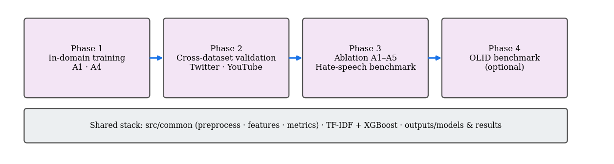

### 4.2 Software Architecture

Code is organised in four phase modules with shared utilities for preprocessing, feature engineering, and metrics. Each phase can be reproduced from the command line or via its notebook.

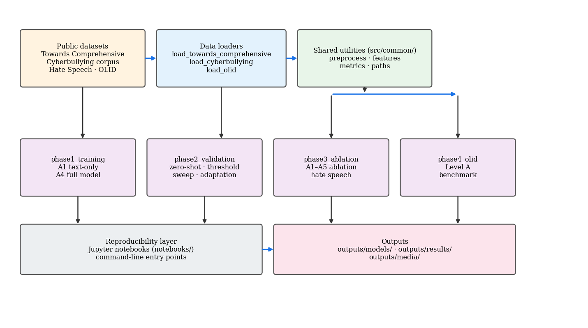

**Leakage-aware validation loading** (`load_cyberbullying.py`, Phase 2 data loader). Only Twitter and YouTube files are loaded for Phase 2; Wikipedia-overlapping subsets are excluded at import time (see Appendix D, §D.5.1).

### 4.3 Feature Engineering and Preprocessing

**Feature engineering** (`feature_engineering.py`) derives `aggression_ratio`, `is_repeat_offender`, and `combined_score` from peerness and message-count fields (Appendix D, §D.5.2).

**Text preprocessing** (`text_preprocessing.py`) strips uniform resource locators (URLs) and @mentions before TF-IDF so high-cardinality tokens do not pollute the vocabulary. The same `preprocess()` function is applied in Phases 1–4.

**TF-IDF vectorisation.** Both `TextOnlyModel` (A1) and `FullModel` (A2–A5) use identical vectoriser settings: `max_features=10,000`, `ngram_range=(1,2)` (unigrams and bigrams), `min_df=2` (terms must appear in at least two documents), and `sublinear_tf=True` (log-scaled term frequency). This yields a sparse matrix of dimension up to 10,000 per message.

**Tabular feature scaling.** Relational columns are standardised with `StandardScaler` (zero mean, unit variance) before concatenation. The final feature matrix joins the sparse TF-IDF block with the dense scaled tabular block via `scipy.sparse.hstack` so XGBoost receives a single hybrid input (Appendix D, §D.5.2).

SubLabel (conversation group 1–12) is **excluded** from all models: cyberbullying positives appear only in odd-numbered groups, so including SubLabel would leak label structure rather than generalisable signal.

Although this project does not use graph neural networks, the Towards Comprehensive dataset has an implicit **user-pair relational structure**: each message links two users, and pair-level attributes (peerness, message counts) describe the edge between them. Figure 4.3 shows how this relational graph is flattened into tabular features and concatenated with TF-IDF text vectors for XGBoost—fulfilling a similar preprocessing role to graph-to-feature pipelines in the literature, but implemented here with sparse text plus scaled tabular columns.

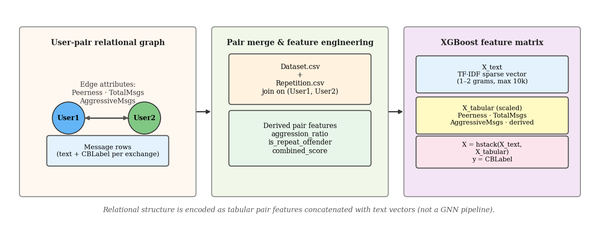

### 4.4 Model Training Pipeline

**Pair-aware split** (`train.py`). Pairs—not individual messages—are assigned to train or test using stratified `train_test_split` on `(User1, User2)` keys (Appendix D, §D.5.3).

**Class imbalance.** Positive-class weighting (`scale_pos_weight = n_neg / n_pos`) is computed from training labels and passed to XGBoost (e.g. 128.02 in Phase 1).

**Ablation configurations** (`ablation.py`). Each variant reuses the same split and `scale_pos_weight`, changing only the tabular columns passed to `FullModel` (A2–A5 column sets in Appendix D, §D.5.3).

**Zero-shot full model placeholders** (Phase 2 — external data lacks relational fields; `validation.py`) use neutral default values for peerness and message-count fields when the full model is evaluated zero-shot.

**Evaluation metrics** (`metrics.py`) — accuracy, precision, recall, F1, ROC-AUC, and confusion matrix — are computed identically for every experiment and saved to JSON (Appendix D, §D.5.3).

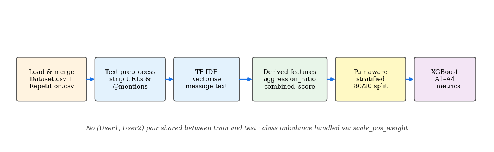

### 4.5 Model and Vectoriser Configuration

**Table 4.1: Fixed hyperparameters (identical across A1–A5)**

| Component | Parameter | Value | Rationale |
|-----------|-----------|-------|-----------|
| TF-IDF | max_features | 10,000 | Caps vocabulary size on ~15.5k messages |
| TF-IDF | ngram_range | (1, 2) | Captures unigrams and short phrases |
| TF-IDF | min_df | 2 | Removes hapax legomena |
| TF-IDF | sublinear_tf | True | Dampens very frequent terms |
| XGBoost | n_estimators | 200 | Sufficient trees for convergence on sparse features |
| XGBoost | max_depth | 6 | Limits overfitting on small positive class |
| XGBoost | learning_rate | 0.1 | Standard default for gradient boosting |
| XGBoost | subsample | 0.8 | Row subsampling for regularisation |
| XGBoost | colsample_bytree | 0.8 | Column subsampling per tree |
| XGBoost | scale_pos_weight | 128.02 | 12,930 negatives ÷ 101 positives (train split) |
| Split | test_size | 0.20 | 80/20 pair-aware hold-out |
| Split | random_state | 42 | Reproducibility |

The classification threshold for binary predictions defaults to 0.50 on predicted positive-class probability. Phase 2 additionally sweeps thresholds {0.10, 0.20, …, 0.50} on validation subsets and selects the threshold maximising F1 on a calibration slice when domain adaptation is applied.

Fixed hyperparameters were used for all ablation experiments to ensure fair comparison across feature configurations. Hyperparameter optimisation (e.g. grid search on training data only) was not performed but could be explored in future work.

**Text-only baseline (A1)** — `baseline_text_only.py` wraps TF-IDF and XGBoost in a single `sklearn` pipeline. **Full model (A2–A5)** — `full_model.py` concatenates sparse text with scaled tabular columns using the default A4 feature list (`Peerness`, message counts, and derived intervention fields). Class definitions are in Appendix D (§D.5.4).

### 4.6 Intervention-Oriented Model Outputs

Detection outputs are designed to support **human-in-the-loop moderation** rather than autonomous sanctions [7, 14]. When the full model (A4) flags a message, three derived fields guide prioritisation:

**Table 4.2: Intervention-oriented derived features and moderator use**

| Field | Definition | Moderator use |
|-------|------------|---------------|
| `aggression_ratio` | AggressiveMsgs ÷ TotalMsgs for the user pair | Severity of repeated harm within the conversation |
| `is_repeat_offender` | 1 if TotalMsgs ≥ 2 and AggressiveMsgs ≥ 1 | Escalation when a pair shows a pattern, not an isolated message |
| `combined_score` | Peerness × aggression_ratio | High-risk close-peer pairs with sustained aggression |

**Prioritisation workflow.** Flagged cases can be routed into a three-tier review queue:

1. **Tier 1 (urgent)** — `combined_score` in the top decile on the training distribution (≥ 0.45) and `is_repeat_offender = 1`: immediate human review, consistent with repeat-offender intervention models discussed by Vinodha et al. [7].
2. **Tier 2 (standard)** — cyberbullying predicted with moderate `combined_score` or high peerness: scheduled moderator review within a standard service-level window.
3. **Tier 3 (monitor)** — borderline scores or first-time pair interactions: log for trend monitoring without immediate escalation.

On the held-out test set, A4 achieved **perfect recall (25/25)**, which minimises missed cyberbullying cases when relational metadata exists—a critical requirement for safeguarding contexts where false negatives are more costly than false positives [14]. The single false positive (1 of 2,445 negatives) illustrates that precision remains high (0.962) under this workflow.

**Deployment constraints.** This pathway requires platforms to maintain user-pair interaction history. Where only text is available (Phase 2 zero-shot), tiered relational routing does not apply; domain-adaptive text-only models (F1 ≈ 0.64) provide a fallback alert channel. A proof-of-concept moderator dashboard implementing this workflow is described in §4.7; future deployment would connect to platform APIs for automatic relational metadata. Phase 2 cross-dataset validation implementation is documented in Appendix D (§D.1). Ethical safeguards remain as in Appendix A.3.

### 4.7 Moderator Dashboard Prototype

A proof-of-concept moderator dashboard implementing the three-tier workflow (§4.6); future deployment would connect to platform APIs for automatic relational metadata. The prototype is separate from the training pipeline and not connected to a live social platform.

**Architecture.** The stack is **FastAPI** (Python REST API) plus a browser **UI** (HTML/CSS/JavaScript). The UI calls `/api/predict` to run inference on saved A1 or A4 model weights. Flagged cases are stored in a **SQLite** audit database and surfaced through `/api/queue`; moderator actions are logged via `/api/review/{id}`. Full API endpoint specification is in Appendix D (Table D.1).

**Inference paths.** With peerness and message-count fields, the API uses model **A4** and applies the same tier rules as §4.6 (`combined_score`, `is_repeat_offender`). Text-only submission routes to **A1**. Outputs are **recommendations only**—the UI requires a moderator to choose approve, dismiss, or escalate; no automated sanctions are applied.

**Demonstration scope.** Relational inputs are entered manually for research demonstration; production systems would populate them from platform message graphs. The prototype runs locally as a FastAPI service with the browser UI shown in Figures 4.5–4.7.

**Demonstration examples.** Two representative inputs illustrate the thesis finding that relational context matters alongside wording—not as additional empirical results, but to show how the §4.6 tier workflow behaves in the UI (Figures 4.5–4.7).

**Table 4.3: Representative dashboard demonstration inputs**

| Scenario | Message (excerpt) | Peerness | TotalMsgs | AggressiveMsgs | Expected outcome |
|----------|-------------------|----------|-----------|----------------|------------------|
| Benign | "Thanks for sharing the notes — really helped for the exam." | 0.55 | 3 | 0 | Not cyberbullying; no urgent queue entry |
| Tier 1 demo | "If you continue this behaviour I am going to report you and get you blocked from the site." | 0.93 | 2 | 1 | Model A4; cyberbullying predicted (~81%); Tier 1 urgent review; case queued |

Submitting a message **without** peerness and message counts routes inference through **A1** (text-only)—the same weak pathway as Phase 1 (F1 = 0.000 on the held-out test set; Section 5.3.1).

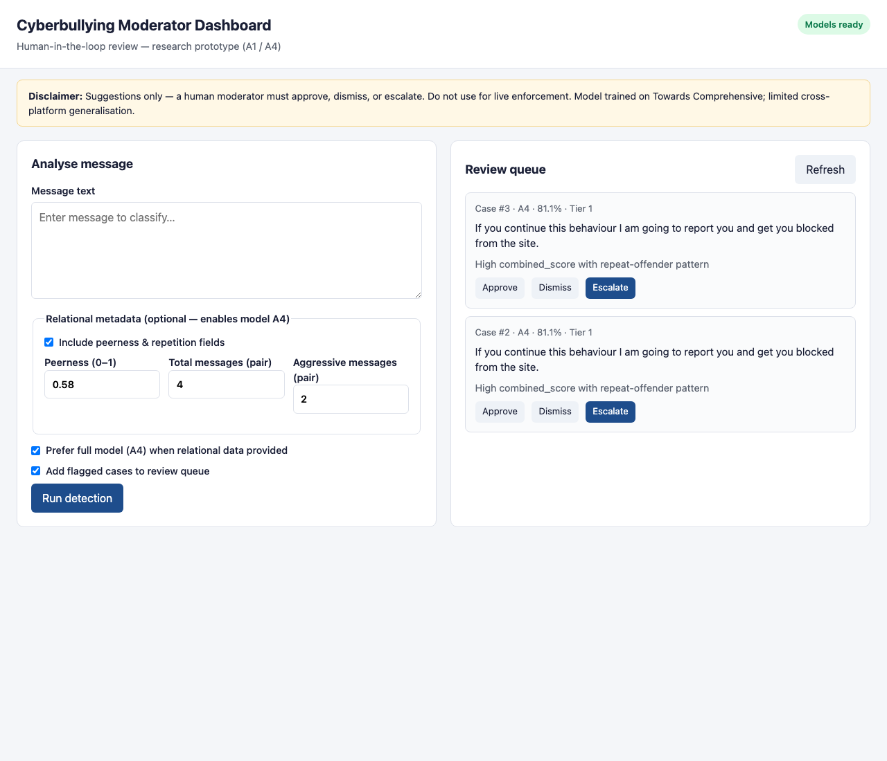

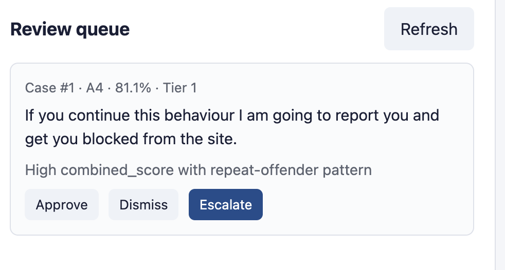

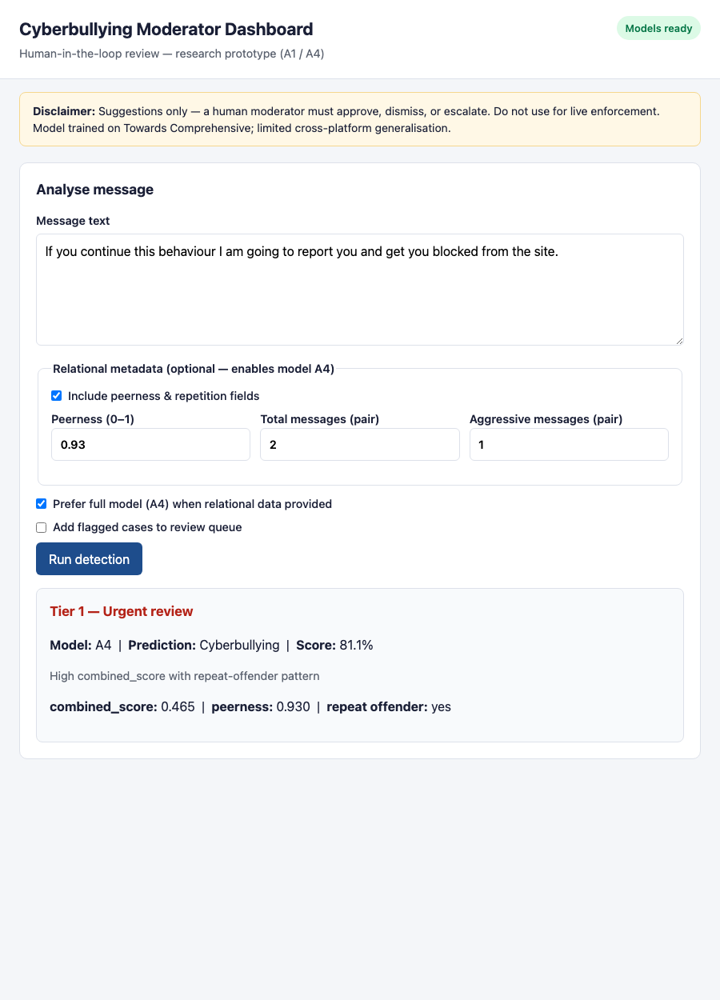

<!-- chapter:5 -->

## 5 Evaluation

This chapter reports data characteristics, experimental design, results across four phases, and critical discussion. A standalone summary of findings, contributions, limitations, and future work is presented in Chapter 6. All results are from the author's implementation and logged as JSON artefacts (Appendix C, Table C.2).

### 5.1 Data

The merged Towards Comprehensive training set contains 15,501 messages after joining `Dataset.csv` with `Repetition.csv` on (User1, User2); 53 rows with missing repetition data were dropped (all negative class). Only 126 messages (0.81%) are labelled as cyberbullying. The pair-aware 80/20 split yields 13,031 training rows (101 positives) and 2,470 test rows (25 positives) across 6,691 train pairs and 1,673 test pairs. Exploratory data analysis (EDA) confirms severe class imbalance in the training distribution (Appendix D, Figure D.1).

**Table 5.1: Relational feature statistics (merged corpus, n = 15,501)**

| Feature | Min | Median | Max | Notes |
|---------|-----|--------|-----|-------|
| Peerness | 0.100 | 0.583 | 0.997 | Pair closeness score |
| TotalMsgs | 1 | 1 | 257 | Messages per user pair |
| AggressiveMsgs | 0 | — | 182 | Aggressive messages per pair |
| aggression_ratio | 0.000 | — | 1.000 | AggressiveMsgs / TotalMsgs |
| is_repeat_offender | 0 | — | 1 | 49.5% of rows flagged |
| combined_score | 0.000 | — | 0.997 | Peerness × aggression_ratio |

There are 8,414 unique (User1, User2) pairs; only 120 pairs contain at least one cyberbullying message. Cyberbullying labels correlate with relational structure: positives appear exclusively in odd-numbered SubLabel groups (1, 3, 5, 7, 9, 11), which is why SubLabel is excluded as a model feature.

**Table 5.2: Cross-dataset validation subset characteristics (Phase 2)**

| Subset | Rows | Positives | Positive rate |
|--------|------|-----------|---------------|
| twitter | 16,848 | 5,347 | 31.7% |
| twitter_racism | 13,471 | 1,970 | 14.6% |
| twitter_sexism | 14,878 | 3,377 | 22.7% |
| youtube | 3,464 | 417 | 12.0% |

Twitter and YouTube validation subsets have substantially higher positive rates (12–32%) than the training corpus (0.81%), reflecting domain shift and different annotation schemes [3, 10]. Wikipedia-sourced aggression, attack, toxicity, and Kaggle subsets are excluded from validation to prevent text overlap with Towards Comprehensive training data.

### 5.2 Experiments

Four experimental phases align with the methodology programme (Figure 3.2). The staged evaluation design, including the adaptation path taken when zero-shot cross-dataset performance was near zero, is shown in Appendix D (Figure D.2).

| Phase | Purpose | Models / methods |
|-------|---------|------------------|
| 1 | In-domain training | A1 (text-only), A4 (full) on Towards Comprehensive |
| 2 | Cross-dataset validation | Zero-shot A1/A4; threshold sweep; domain adaptation; embedding extension |
| 3 | Ablation and hate-speech benchmark | A1–A5 ablation; Davidson 3-class benchmark |
| 4 | OLID offensive-language benchmark (optional) | Zero-shot A1 vs in-domain A1 on Level A |

The optional OLID benchmark (row 4) is reported in §5.3.4.

**Evaluation design choices.** (1) **Pair-aware splitting** ensures the same (User1, User2) conversation never appears in both train and test. (2) **Threshold calibration** in Phase 2 uses a held-out slice of validation data; final test metrics are reported separately. (3) **Three random seeds** for domain-adaptive experiments report mean F1, standard deviation, and 95% CI. (4) **Placeholder relational values** for zero-shot A4 on Twitter/YouTube demonstrate that the full model requires genuine peerness and repetition fields.

### 5.3 Results

#### 5.3.1 Phase 1 — In-Domain Training

**Table 5.3: In-domain training results (Towards Comprehensive, held-out test set)**

| Model | Precision | Recall | F1 | ROC-AUC |
|-------|-----------|--------|-----|---------|
| A1 (text only) | 0.000 | 0.000 | 0.000 | 0.510 |
| A4 (full) | 0.962 | 1.000 | **0.980** | **0.9999** |

**Interpretation — A1 did not fail to train.** The text-only model completed training on 13,031 messages (101 positives in the train split) with class weighting (`scale_pos_weight` = 128.02) and was saved as `baseline_a1.joblib`. Metrics were computed on the held-out test set (n = 2,470; 25 cyberbullying positives). The zero precision, recall, and F1 values reflect **prediction behaviour on the test set**, not a software or convergence error.

**Why precision, recall, and F1 are all 0.000.** Under severe imbalance, scikit-learn reports precision, recall, and F1 on the positive (cyberbullying) class. A1 **never assigns a true positive**: every one of the 25 cyberbullying test messages is predicted as non-cyberbullying (25 false negatives). Although the model flags 59 non-cyberbullying messages as cyberbullying (59 false positives), there are **zero true positives**, so:

- **Precision** = TP ÷ (TP + FP) = 0 ÷ 59 = **0.000** (none of the flagged messages are correct)
- **Recall** = TP ÷ (TP + FN) = 0 ÷ 25 = **0.000** (no cyberbullying case is detected)
- **F1** = 0.000 (harmonic mean of precision and recall when recall is zero)

**Why this outcome is expected on Towards Comprehensive — not a broken baseline.**

1. **Labels align with relational context, not distinctive text.** On this corpus, cyberbullying annotations correlate more strongly with peerness and repetition than with vocabulary that separates positives from negatives in TF-IDF space [1]. Message text alone does not carry sufficient discriminative signal.
2. **Extreme rarity of positives.** Only 126 messages (0.81%) in the full corpus are positive; the test set contains just 25 positives among 2,470 messages. Text-only models on similar imbalanced tasks often collapse toward the majority class even with `scale_pos_weight` [14, 15].
3. **Accuracy is misleading.** A1 accuracy = 0.966 (96.6%), which can look acceptable until one notes that **98.99% of the test set is negative** — a classifier that never finds cyberbullying still appears accurate.
4. **ROC-AUC ≈ 0.51 indicates near-random ranking.** AUC = 0.510 is barely above chance (0.50): the model has almost no ability to rank cyberbullying messages above non-cyberbullying messages using text features alone. This confirms weak text signal rather than failed optimisation.
5. **Tuning does not rescue text-only performance.** Hyperparameter search on the training split improves text-only F1 only to approximately **0.035** — still far below A2 with peerness alone (F1 = 0.645). The bottleneck is **missing relational features**, not inadequate training configuration.
6. **Supports the research question.** A1 establishes the text-only lower bound deliberately. Ablation shows that adding peerness (A2: F1 = 0.645) and the full relational set (A4: F1 = 0.980) produces the large gain reported in Table 5.6 — the central finding of this dissertation.

A4 catches all 25 positives with 1 false positive (see Figure 5.1 for A1 and Figure 5.2 for A4; Table 5.3).

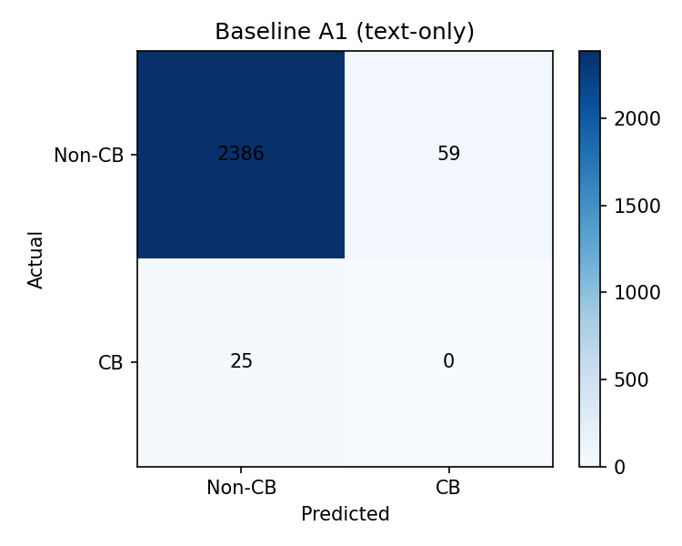

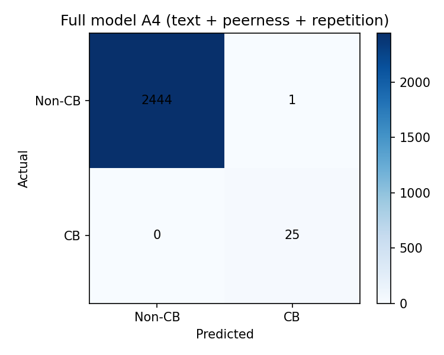

#### 5.3.2 Phase 2 — Cross-Dataset Validation

**Table 5.4: Zero-shot text-only validation (A1, threshold = 0.50)**

| Subset | F1 | ROC-AUC |
|--------|-----|---------|
| twitter | 0.034 | 0.512 |
| twitter_racism | 0.023 | 0.492 |
| twitter_sexism | 0.040 | 0.524 |
| youtube | 0.005 | 0.375 |

Zero-shot full model (A4 with placeholders): F1 = 0.000 on all subsets. The placeholder relational values (Peerness = 0.5, TotalMsgs = 1, etc.) cannot approximate genuine pair history on external platforms, so the full model collapses to predicting all negatives.

**Threshold sensitivity.** A sweep over decision thresholds {0.10–0.50} on zero-shot A1 shows that best F1 is always at the lowest threshold (0.10), trading precision for recall: Twitter F1 rises from 0.034 (threshold 0.50) to 0.264 (threshold 0.10), but remains far below in-domain performance. YouTube ROC-AUC = 0.375 is below chance (0.50), indicating systematic miscalibration on that domain even before threshold selection.

**Table 5.5: Domain adaptation (20% adapt, 80% test)**

| Subset | Method | F1 | Recall | ROC-AUC |
|--------|--------|-----|--------|---------|
| Twitter (primary) | Domain-adaptive fine-tune | 0.633 | 0.674 | 0.803 |
| Twitter (primary) | Embedding extension (SVD+LogReg) | **0.644** | **0.705** | **0.817** |
| YouTube (secondary) | Domain-adaptive fine-tune | 0.209 | 0.219 | 0.593 |
| YouTube (secondary) | Embedding extension (SVD+LogReg) | 0.159 | 0.099 | 0.664 |

Twitter is reported as the **primary adaptation subset** because it is the largest validation file (n = 16,848) and supports stable threshold calibration. YouTube (n = 3,464) yields lower adaptation F1 and near-chance zero-shot ROC-AUC (0.375), reflecting both smaller sample size and stronger domain shift relative to Wikipedia-derived training text. Robustness on Twitter (3 seeds): embedding extension mean F1 = 0.643, std = 0.004, 95% CI [0.639, 0.646].

All top-20 high-confidence Twitter errors were false positives — offensive Twitter language flagged as cyberbullying (annotation mismatch between Wikipedia-dialogue cyberbullying labels and Twitter toxicity/racism/sexism annotations).

**Interpretation.** Zero-shot failure confirms that models trained on Wikipedia-derived dialogue with relational features do not transfer lexically or calibratively to social-media text. Domain-adaptive fine-tuning on 20% of Twitter labels (2,526 fit rows, 843 calibration, 13,479 test) recovers usable F1 (~0.64) using text-only pathways. The embedding extension (TF-IDF → TruncatedSVD with 300 components → balanced LogisticRegression) marginally improves recall and ROC-AUC on Twitter, suggesting dense reduced embeddings generalise more smoothly than sparse high-dimensional TF-IDF on out-of-domain text. YouTube adaptation remains weaker (F1 ≤ 0.21), consistent with its smaller labelled pool and below-chance zero-shot ranking.

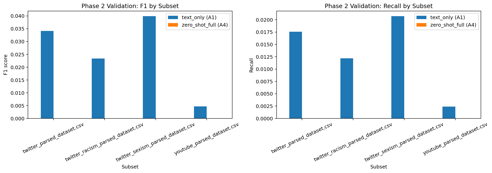

#### 5.3.3 Phase 3 — Ablation and Hate-Speech Benchmark

**Table 5.6: Ablation study results (in-domain test set)**

| Model | F1 | ROC-AUC | TP / 25 |
|-------|-----|---------|---------|
| A1 — text only | 0.000 | 0.509 | 0 |
| A2 — text + peerness | 0.645 | 0.995 | 20 |
| A3 — text + repetition | 0.067 | 0.686 | 5 |
| A4 — full | **0.980** | **0.9999** | 25 |
| A5 — full + demographics | 0.980 | 0.9999 | 25 |

Peerness drives the largest gain (A1→A2: +0.645 F1). Repetition alone is noisy (A3: F1 = 0.067, 120 false positives) because raw counts without relationship context over-flag pairs with high message volume. Combining peerness with repetition (A2→A4: +0.335 F1) yields near-perfect discrimination. Demographics add nothing (A5 = A4), indicating age and gender encodings do not improve detection beyond relational features on this corpus.

**Feature importance (Model A4).** XGBoost gain-based importances on the held-out training configuration aggregate the 10,000 TF-IDF dimensions into a single text block and rank tabular features individually. Appendix D (Figure D.3) shows that **Peerness** and **combined_score** dominate the relational block, corroborating the ablation result that relationship context—not message wording alone—drives predictions on Towards Comprehensive.

**Table 5.7: Hate speech benchmark (Davidson et al., 3-class, n = 4,957 test)**

| Model | Macro-F1 | Accuracy |
|-------|----------|----------|
| TF-IDF + LogReg (balanced) | **0.740** | 0.884 |
| TF-IDF + XGBoost | 0.724 | 0.910 |

Davidson et al. [3] show that separating hate speech, offensive language, and neither improves precision over conflated binary labelling on the same Twitter corpus. The implemented TF-IDF + balanced LogReg baseline (macro-F1 = 0.740) and TF-IDF + XGBoost (macro-F1 = 0.724) are consistent with that finding: both models perform credibly on an established 3-class task using the same feature family Davidson et al. employ, positioning this pipeline within published hate-speech benchmarks rather than cyberbullying-specific leaderboard claims.

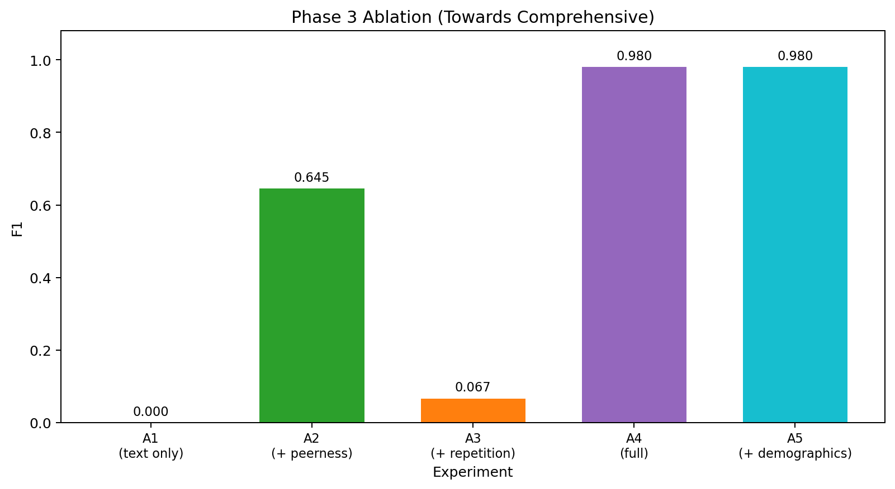

#### 5.3.4 OLID Benchmark (Optional)

This optional benchmark evaluates offensive-language identification on the Offensive Language Identification Dataset Level A from SemEval-2019 [5]: each tweet is labelled **offensive (OFF)** or **not offensive (NOT)**. It fulfils Objective 4 and the MoSCoW Should-have evaluation criterion for external benchmark alignment alongside the Davidson hate-speech corpus, and tests the A1 text-only pathway on a second established reference dataset—distinct from cyberbullying validation on Twitter/YouTube.

Cyberbullying and offensive-language detection are related but not identical [3, 5, 15]. The benchmark serves three purposes: compare TF-IDF + XGBoost against a widely cited corpus; test whether a Towards Comprehensive–trained model transfers without retraining; and confirm credible performance when trained on OLID's own distribution. Relational features are out of scope—OLID provides tweet text only, so the full model (A4) is not evaluated here.

**Evaluation modes.**

| Mode | Procedure | Question addressed |
|------|-----------|-------------------|
| Zero-shot | A1 model from in-domain training applied to OLID test tweets, no OLID training | Does a cyberbullying text model transfer to offensive-language detection? |
| In-domain | Fresh `TextOnlyModel` (TF-IDF + XGBoost) trained on OLID train, evaluated on OLID test | Does the architecture perform on the target task and distribution? |

**Dataset.** OLID Level A test set: n = 860 tweets, 240 offensive (27.9% positive)—substantially higher than Towards Comprehensive (0.81%), reflecting different annotation scope (general offensiveness vs. pair-level cyberbullying).

**Table 5.8: OLID Level A benchmark results**

| Configuration | F1 | ROC-AUC |
|---------------|-----|---------|
| Zero-shot (Phase 1 A1) | 0.000 | 0.501 |
| In-domain (train on OLID) | 0.608 | 0.793 |

**Interpretation.**

- **Zero-shot (F1 = 0.000, ROC-AUC = 0.501):** Transfer from Towards Comprehensive to OLID fails completely—performance is at chance. This aligns with cross-dataset zero-shot results (§5.3.2) and confirms that task definition, platform, and annotation scheme must align for deployment.
- **In-domain (F1 = 0.608, ROC-AUC = 0.793):** Training on OLID's own distribution recovers meaningful performance, validating the implementation and showing that poor zero-shot scores reflect domain and task shift, not pipeline errors.
- **With Davidson hate-speech (macro-F1 = 0.724–0.740):** Both external benchmarks support Objective 4 and characterise when the text-only pathway generalises and when it does not.

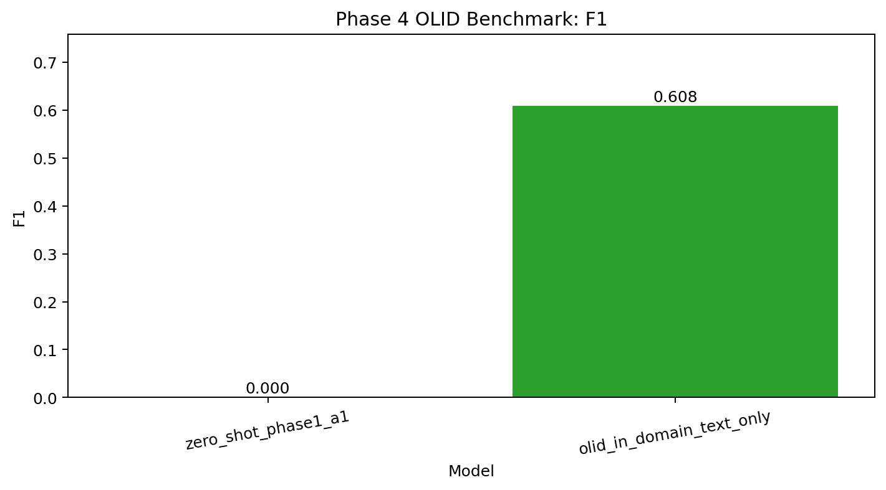

**Table 5.9: Summary of key results across all phases**

| Phase | Experiment | F1 | ROC-AUC |
|-------|-----------|-----|---------|
| 1 | A1 text-only | 0.000 | 0.510 |
| 1 | A4 full | 0.980 | 0.9999 |
| 2 | Zero-shot twitter | 0.034 | 0.512 |
| 2 | Embedding extension | 0.644 | 0.817 |
| 3 | A2 + peerness | 0.645 | 0.995 |
| 3 | A4 full ablation | 0.980 | 0.9999 |
| 4 | OLID in-domain | 0.608 | 0.793 |

### 5.4 Discussion

**Requirements fulfilment.** Functional requirements R1, R3, R5, and R6 are fulfilled: A4 achieves F1 = 0.980 with perfect recall in-domain (R1); Phase 2 reports zero-shot and adapted Twitter/YouTube results (R3); §4.6 tier rules and derived features support intervention (R5); and only non-overlapping Twitter/YouTube subsets are used for validation (R6). Evaluation-quality criteria—structured ablation and external benchmarking—are also fulfilled. Full requirement-to-evidence mappings appear in Appendix D (Tables D.2–D.3).

**Answering the research question:** Relational features substantially improve in-domain detection (F1: 0.000 → 0.980) when peerness and repetition are available. Peerness is the dominant signal — a single score per user pair raises F1 from 0.000 to 0.645 (A2). Repetition alone is noisy without relationship context (A3: 120 false positives) but complementary when combined with peerness (A2→A4: +0.335 F1). The in-domain advantage does not transfer zero-shot to Twitter/YouTube; adaptation recovers text-only F1 to ~0.64.

**Why text alone fails:** On Towards Comprehensive, cyberbullying labels correlate with relational patterns more than distinctive vocabulary. With only 126 positives (0.81%) and 101 positive training examples, A1 achieves **zero true positives** on the test set (25 FN, 0 TP) despite `scale_pos_weight` = 128.02 — it flags 59 non-cyberbullying messages incorrectly but never identifies an actual cyberbullying case. ROC-AUC of 0.510 confirms near-random text-only ranking (see §5.3.1).

**Domain shift:** Twitter validation subsets have positive rates of 12–32% vs 0.81% in training. Error analysis shows false positives on offensive Twitter language (annotation mismatch) [3]. OLID zero-shot fails (AUC = 0.501) but in-domain succeeds (F1 = 0.608).

**Intervention and moderator support (R5).** Tables 4.2 and D.4 map intervention criteria to model features and the §4.6 tier rules. The moderator dashboard (§4.7, Figures 4.5–4.7) provides a concrete human-in-the-loop path for R5: flagged cases enter a review queue and await approve, dismiss, or escalate—supporting the PLES principle that detection outputs must not trigger autonomous enforcement [14].

**Comparison with prior work.** Table D.5 situates this dissertation against the studies reviewed in Chapter 2: relational signals are quantified per-feature (vs Ejaz et al. [1]); text-only baselines fail on Towards Comprehensive (vs message-level NLP work [9, 13]); the architecture generalises to Davidson hate-speech and OLID benchmarks when distributions align; zero-shot cross-platform transfer remains weak without adaptation; and leakage controls follow Wulczyn et al. [10].

Hyperparameter tuning experiments confirm that the A1 failure is not an artefact of suboptimal settings: the best tuned text-only XGBoost on Phase 1 data reaches F1 = 0.035—still far below A2 (0.645)—indicating a **feature availability** problem rather than a tuning problem.

The experimental programme addresses the gaps identified in Section 2.3: relational features are quantified through ablation; cross-platform behaviour is tested on Twitter and YouTube with leakage controls; intervention relevance is operationalised through derived features and error analysis. A consolidated summary of contributions, limitations, and future directions is presented in Chapter 6.

<!-- chapter:6 -->

## 6 Conclusion

This chapter summarises the principal findings of the research, restates the contributions in light of the literature reviewed in Chapter 2, acknowledges limitations, and outlines directions for future work.

### 6.1 Summary of Findings

The research question — *What contribution do relational and behavioural features make to cyberbullying detection compared with text-only approaches?* — was answered through models A1–A4, leakage-aware validation on Twitter and YouTube, external benchmarking, and the multi-phase programme in Chapters 3–5.

On Towards Comprehensive, text-only detection failed in-domain (A1: F1 = 0.000) while the full model achieved F1 = 0.980 with perfect recall. Ablation isolated **peerness** as the dominant signal (+0.645 F1); repetition helped only with peerness (+0.335 F1 from A2→A4). Zero-shot transfer to Twitter/YouTube was near zero; Twitter domain adaptation recovered text-only F1 to ~0.64, while YouTube adaptation remained weaker (F1 ≤ 0.21). Davidson hate-speech benchmarking (macro-F1 = 0.724–0.740) and Offensive Language Identification Dataset Level A (in-domain F1 = 0.608) confirm the text pipeline is sound on established offensive-language tasks when training and evaluation distributions align. Full metric tables and interpretation appear in Chapter 5.

### 6.2 Contributions

This dissertation makes five main contributions to cyberbullying detection research:

1. **Multi-dimensional detection model** — Integration of TF-IDF text features with peerness, repetition, and intervention-oriented derived features (`aggression_ratio`, `is_repeat_offender`, `combined_score`) in a reproducible phase-based pipeline.
2. **Structured ablation study** — Quantification of peerness as the dominant in-domain signal (+0.645 F1) and repetition as complementary (+0.335 F1 when combined with peerness), addressing the gap identified in Ejaz et al. [1].
3. **Leakage-aware validation design** — Independent Twitter and YouTube evaluation with explicit exclusion of Wikipedia-overlapping subsets [10], following lessons from personal-attack corpora.
4. **Cross-task benchmarking and adaptation** — Hate-speech and OLID benchmarks, threshold-sensitivity analysis, domain-adaptive fine-tuning, and robustness checks that characterise when the model generalises and when it does not.
5. **Moderator dashboard prototype** — A local FastAPI + browser UI demonstrates tiered review and audit logging for R5 (§4.7), without live platform deployment.

`is_repeat_offender` and `combined_score` prioritise high-risk user pairs when relational metadata is available on-platform.

### 6.3 Limitations

Several limitations constrain the generalisability and deployment readiness of the findings:

- **Training corpus.** Towards Comprehensive uses Wikipedia-derived dialogue with synthetic user structure; only 126 messages (0.81%) are positive. Results may not transfer to live social-media streams without adaptation.
- **Relational feature dependency.** A4's in-domain success depends on peerness and repetition fields that are unavailable on most external platforms; zero-shot full-model transfer is not viable without genuine pair-level metadata.
- **Text-only insufficiency.** On this corpus, message text alone does not discriminate cyberbullying labels; deployments limited to text will require domain adaptation or alternative feature sources.
- **Fixed hyperparameters.** Hyperparameters were held constant across A1–A4 for fair ablation; tuning could improve absolute scores but would not change the relative ranking observed in ablation.
- **Scope.** Multi-modal detection [6, 8], transformer fine-tuning, live platform integration, and primary data collection are out of scope. The moderator dashboard (§4.7) is a local prototype with manual relational inputs—not evaluated with end users at scale.

### 6.4 Future Work

Building on the findings and limitations above, the following directions are recommended:

1. **Hyperparameter optimisation** — Grid or Bayesian search on training data only, with pair-aware cross-validation, to establish upper bounds per configuration without confounding ablation fairness.
2. **Transformer embeddings** — Sentence-BERT [12] or domain-adapted language models to improve text-only cross-domain transfer where relational features are absent.
3. **Explainability and fairness** — Feature-importance analysis for XGBoost; error analysis by demographic subgroup; auditing for dialect or group bias before deployment [14].
4. **Multi-modal extensions** — Incorporate image and video channels following Manju Sri et al. [6] and Jaiswal and Attri [8] when labelled multi-modal cyberbullying corpora become available.
5. **Live-platform evaluation** — Partner with educators or platform moderators to evaluate on ethically approved, anonymised production data with human-in-the-loop review.
6. **Dashboard integration** — Connect the moderator dashboard prototype to platform APIs for automatic peerness and repetition fields, authenticated moderator roles, and production-grade audit storage.

### 6.5 Closing Remarks

Cyberbullying detection cannot rely on message text alone when labels correlate with who is involved and how often harm occurs. This dissertation demonstrates that relational features—especially peerness—provide decisive in-domain signal on Towards Comprehensive, while also showing that such advantages do not transfer zero-shot across platforms. The practical implication is a **two-track deployment strategy**: where pair-level metadata exists, the full model (A4) maximises recall for moderator intervention; where only text is available, domain-adaptive text-only models with calibrated thresholds are necessary. Future systems should combine robust cross-domain text classifiers with relational feature pipelines where platform architecture permits ethical collection of interaction history.

<!-- appendix:a -->

## Appendix A: Project Management

### A.1 Work Plan

This appendix documents the project work plan, risk analysis, and professional, legal, ethical and societal (PLES) considerations. The schedule below extends the initial eight-week F21RP research plan into the full F21MP implementation and dissertation-writing timeline.

**Table A.1: Project schedule (F21RP planning → F21MP delivery)**

| Stage | Period | Activities |
|-------|--------|------------|
| F21RP — Research planning | Weeks 1–8 | Literature review, requirements (MoSCoW), methodology design, leakage analysis, initial Gantt |
| F21MP — Data and baselines | Weeks 9–12 | Load/merge Towards Comprehensive; EDA; implement A1 and A4; pair-aware splitting |
| F21MP — Evaluation programme | Weeks 13–18 | Cross-dataset validation; ablation A1–A5; Davidson and OLID benchmarks; artefact logging |
| F21MP — Analysis and writing | Weeks 19–24 | Error analysis, figures, dissertation drafting, supervisor review, final submission |

The eight-week Gantt in Table A.2 and Figure A.1 reflects the **core implementation milestones** from the original research plan; the extended schedule above situates those milestones within the full MSc dissertation period.

**Table A.2: Eight-week implementation Gantt (core milestones)**

| Task | W1 | W2 | W3 | W4 | W5 | W6 | W7 | W8 |
|------|:--:|:--:|:--:|:--:|:--:|:--:|:--:|:--:|
| Load, merge, explore Towards Comprehensive | ■ | | | | | | | |
| Feature engineering, text preprocessing | | ■ | | | | | | |
| Implement baseline (text-only) | | | ■ | | | | | |
| Implement full model | | | | ■ | | | | |
| Run ablation studies (A1–A4) | | | | | ■ | | | |
| Validation (Twitter, YouTube) | | | | | | ■ | | |
| Benchmark (Hate Speech; OLID) | | | | | | | ■ | |
| Analysis, writing, visualisation | | | | | | | | ■ |

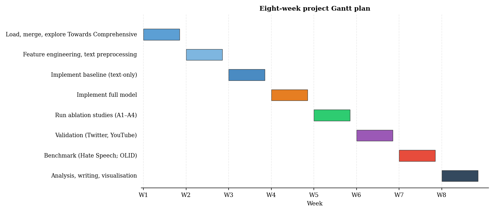

### A.2 Risk Analysis and Mitigation

**Table A.3: Risk assessment**

| Risk | Likelihood | Impact | Mitigation |
|------|------------|--------|------------|
| Data leakage | Medium | High | Twitter/YouTube only; document exclusion |
| Class imbalance | High | Medium | scale_pos_weight; F1 over accuracy |
| Hardware constraints | Low | Medium | TF-IDF + XGBoost; no graphics processing unit (GPU) required |
| Scope creep | Medium | Medium | Text + relational only |
| Delays | Medium | Medium | Phased Gantt plan |

### A.3 Professional, Legal, Ethical and Societal (PLES) Considerations

#### A.3.1 Professional Considerations

Reproducibility is supported through public datasets, a clear validation strategy (Twitter and YouTube only), and phase-based implementation. Code and data sources are cited. Standard machine learning practice (stratified splits, no leakage, ablation studies) and metrics (F1, precision, recall) align with natural language processing and social computing norms [13, 15]. Limitation: the model is trained on Wikipedia-derived and synthetic user structure; generalisation to other platforms is limited. Deployed systems should be accompanied by documentation of training data scope, decision thresholds, and known failure modes so moderators can interpret outputs responsibly.

#### A.3.2 Legal Considerations

All datasets are publicly available and used in accordance with their stated terms (Mendeley Data, Kaggle, GitHub, SemEval shared tasks). No personal data are collected; no scraping of live social media is performed. Under the United Kingdom General Data Protection Regulation, secondary use of anonymised research corpora does not involve processing identifiable living individuals in this project, but any production deployment would require lawful basis, data-minimisation, and retention policies aligned with platform terms of service. Code and outputs respect university programme policies on intellectual property and third-party resources.

#### A.3.3 Ethical Considerations

Automated detection can perpetuate bias—for example, over-flagging certain dialects, communities, or informal speech styles that correlate spuriously with training labels [14, 15]. False positives may harm users through unwarranted sanctions; false negatives may leave victims unsupported. The project is framed for positive intervention (moderator assistance, repeat-offender prioritisation), not surveillance or autonomous punishment. Human-in-the-loop review is mandatory before enforcement actions. All data are secondary and publicly available; no surveys or social media scraping are conducted. Where illustrative offensive content is discussed, wording is censored to avoid gratuitous harm to readers.

#### A.3.4 Societal Considerations

Deployed systems could affect freedom of expression and user trust, particularly among adolescents who may self-censor if they believe messages are monitored algorithmically. Explainability (confusion matrices, feature-level ablation, tiered review queues) supports accountable moderation. Stakeholders include educators, platform moderators, safeguarding teams, and mental health support services. Benefits must be weighed against chilling effects on legitimate discourse; tiered workflows (§4.6) route only high-risk cases for urgent review rather than blanket automated blocking.

<!-- appendix:b -->

## Appendix B: Requirements Analysis

### B.1 MoSCoW Prioritisation

Requirements were prioritised using the Must have, Should have, Could have, Won't have (MoSCoW) framework.

**Table B.1: MoSCoW requirement priorities**

| Priority | Requirements / criteria | Rationale |
|----------|-------------------------|-----------|
| Must have | R1, R3, R6 | Core deliverables: training model (text + peerness + repetition), validation on independent data, and no validation leakage. |
| Should have | Structured ablation (A1–A4); external benchmarking | Comparative evaluation and alignment with published hate-speech/offensive-language corpora (Objectives 2 and 4). |
| Could have | R5 | Intervention pathway delivered via §4.6 tier rules, Table D.4, and dashboard prototype (§4.7). |
| Won't have | Multi-modal detection, real-time deployment, new data collection | Out of scope; documented as limitations. |

### B.2 Functional Requirements

Functional requirements describe what the detection system must *do*. Comparative ablation and external benchmarking are evaluation-quality criteria (Appendix B.3), not functional product features.

**Table B.2: Functional requirements**

| ID | Requirement | Source | How evaluated |
|----|-------------|--------|---------------|
| R1 | Build detection model using text, peerness, repetition from Towards Comprehensive | Objective 1 | Phase 1 training pipeline |
| R3 | Validate on independent Twitter/YouTube data | Objective 3 | Phase 2 cross-dataset metrics |
| R5 | Support intervention discussion | Objective 5 | §4.6 workflow, Tables 4.2 and D.5, error analysis |
| R6 | Avoid data leakage in validation | Methodology | Exclude aggression/attack/toxicity files |

### B.3 Evaluation-Quality Criteria

These criteria govern *how rigorously* the system is assessed. They support Objectives 2 and 4 and align with Fortuna and Nunes [15] on comparative evaluation in harmful-language research.

**Table B.3: Evaluation-quality criteria**

| Criterion | Source | How evaluated |
|-----------|--------|---------------|
| Structured ablation (A1–A4) | Objective 2 | Phase 3 ablation table (Table 5.6) |
| External benchmarking (hate speech and offensive language) | Objective 4 | Davidson 3-class benchmark; Offensive Language Identification Dataset Level A (§5.3.4) |

### B.4 Non-Functional Requirements

**Table B.4: Non-functional requirements**

| Priority | Non-functional requirement | Rationale |
|----------|----------------------------|-----------|
| Must have | Reproducibility: code and data paths documented; stratified splits; no leakage | Essential for validity |
| Must have | Performance: model trainable on typical hardware | Enables completion within scope |
| Should have | Interpretability: F1, precision, recall, confusion matrix per experiment | Supports comparison |
| Should have | Evaluation rigour: ablation and external benchmarks reported with imbalance-aware metrics | Supports credible comparison with prior work |
| Could have | Extensibility: modular phase-based code; moderator dashboard prototype | Future platform integration |
| Won't have | Real-time deployment, multi-modal pipelines | Out of scope |

<!-- appendix:c -->

## Appendix C: Reproducibility

This appendix records the software environment and primary result artefacts so experiments can be replicated from the implementation described in Chapter 4.

**Table C.1: Software environment**

| Component | Version / setting |
|-----------|-------------------|
| Python | 3.13 |
| pandas | ≥ 1.5.0 |
| scikit-learn | ≥ 1.2.0 |
| XGBoost | ≥ 1.7.0 |
| numpy | ≥ 1.23.0 |
| matplotlib | ≥ 3.5.0 |
| Random seeds | 42 (splits, training); 13, 42, 77 (adaptation robustness) |
| Class weighting | `scale_pos_weight` = 128.02 (Phase 1 train split) |

**Table C.2: Primary result artefacts**

| File | Contents |
|------|----------|
| `phase1_test_metrics.json` | A1 and A4 in-domain test metrics |
| `phase2_validation_text_only.json` | Zero-shot A1 per validation subset |
| `phase2_domain_adaptive_finetune.json` | Twitter domain-adaptive fine-tune |
| `phase2_embedding_extension.json` | Twitter embedding-extension adaptation |
| `phase2_adaptation_robustness_summary.csv` | 3-seed robustness (Twitter) |
| `phase3_ablation_a1_a4.json` | Ablation A1–A5 metrics |
| `phase3_hate_speech_benchmark.json` | Davidson 3-class benchmark |
| `phase4_olid_benchmark.json` | OLID zero-shot and in-domain results |

Trained model weights are saved as `baseline_a1.joblib` and `full_a4.joblib`. Evaluation figures appear in Chapters 4–5 and Appendix D; primary metric files are listed in Table C.2.

<!-- appendix:d -->

## Appendix D: Supplementary Implementation and Evaluation Material

This appendix holds technical detail and supplementary figures moved out of the main chapters to keep the body within the recommended length. Results discussed in the main text are unchanged.

### D.1 Cross-Dataset Validation Implementation

Phase 2 (`validation.py`) implements zero-shot evaluation, threshold calibration, and domain adaptation on the Twitter/YouTube subsets loaded by `load_twitter_youtube_only()`.

**Domain-adaptive fine-tuning** retrains a text-only `TextOnlyModel` on 20% of the target subset (75% fit / 25% calibration for threshold selection; 80% held-out test):

```python
X_adapt, X_test, y_adapt, y_test = train_test_split(
    X, y, test_size=0.80, random_state=42, stratify=y,
)
X_fit, X_calib, y_fit, y_calib = train_test_split(
    X_adapt, y_adapt, test_size=0.25, random_state=42, stratify=y_adapt,
)
model = TextOnlyModel(scale_pos_weight=pos_weight, random_state=42)
model.fit(X_fit, y_fit)
threshold, _ = _find_best_threshold(y_calib, model.predict_proba(X_calib))
```

**Embedding extension** applies TF-IDF → 300-dimensional SVD → `StandardScaler` → balanced `LogisticRegression` using the same adapt/calibration protocol:

```python
pipe = Pipeline([
    ("tfidf", TfidfVectorizer(max_features=25000, ngram_range=(1, 2), min_df=2, sublinear_tf=True)),
    ("svd", TruncatedSVD(n_components=300, random_state=42)),
    ("scale", StandardScaler()),
    ("clf", LogisticRegression(max_iter=400)),
])
pipe.fit(X_fit, y_fit)
test_proba = pipe.predict_proba(X_test)[:, 1]
```

Threshold is selected on the calibration split to maximise F1; final metrics are reported on the held-out 80% test partition. A three-seed robustness check (`seeds = 13, 42, 77`) repeats both adaptation paths and reports mean F1 with a 95% bootstrap confidence interval. Results are reported in §5.3.2.

### D.2 OLID Benchmark Implementation

`run_olid_benchmark()` in `load_olid.py` maps SemEval-2019 subtask A labels (OFF = offensive, NOT = not offensive) to binary form, then runs two evaluations in one pass: **zero-shot** (the saved A1 model from in-domain training applied to OLID test tweets) and **in-domain** (a fresh `TextOnlyModel` fitted on OLID train and evaluated on OLID test). Results are saved to `phase4_olid_benchmark.json` (Table C.2). Only the text-only pathway applies—OLID provides tweet text without peerness or repetition fields. Results are reported in §5.3.4.

### D.3 Moderator Dashboard API

**Table D.1: Moderator dashboard API endpoints**

| Method | Path | Purpose |
|--------|------|---------|
| `GET` | `/api/health` | Model availability and prototype disclaimer |
| `POST` | `/api/predict` | Classify message; optional relational fields for A4 |
| `GET` | `/api/queue` | Pending cases awaiting human review |
| `POST` | `/api/review/{id}` | Approve, dismiss, or escalate a queued case |
| `GET` | `/api/cases` | Recent case history for audit |

### D.4 Supplementary Evaluation Figures

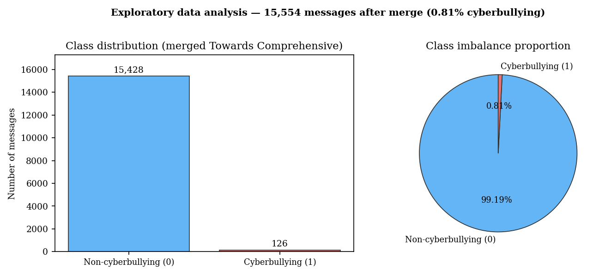

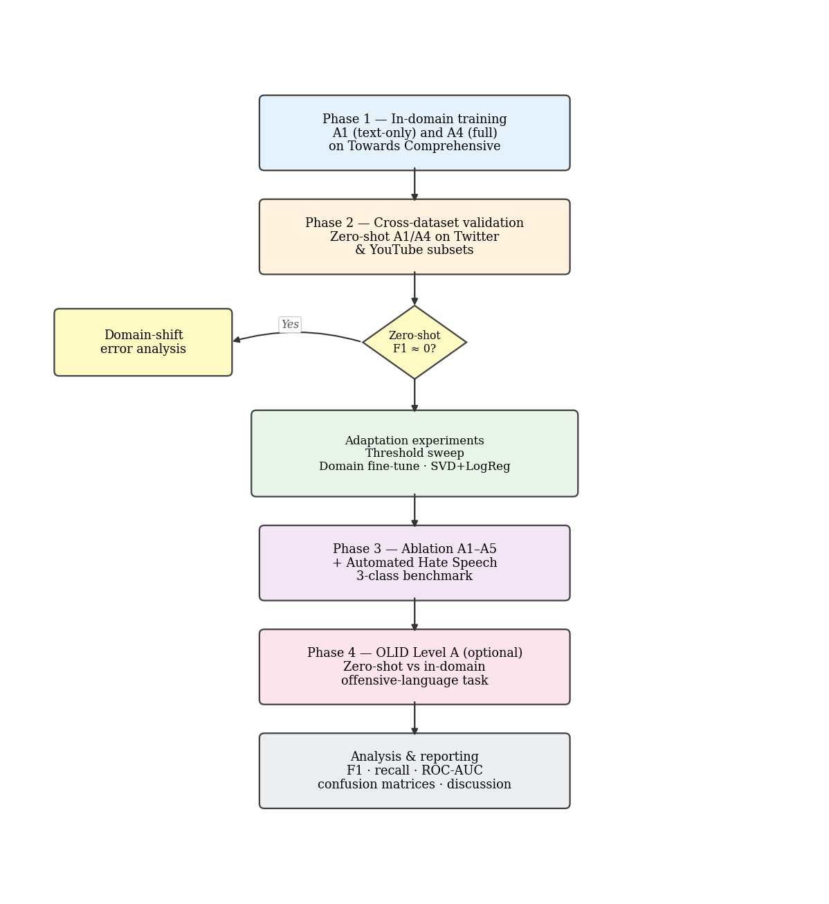

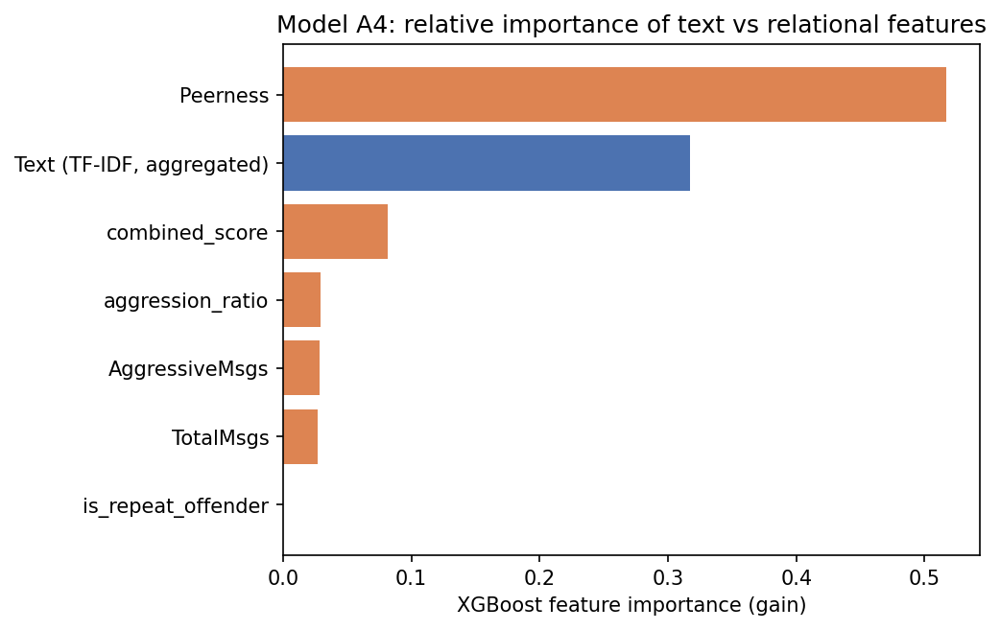

### D.5 Core Pipeline Code Listings

#### D.5.1 Leakage-aware validation loading (`load_cyberbullying.py`)

```python
VALIDATION_FILES = [
    "twitter_parsed_dataset.csv",
    "twitter_racism_parsed_dataset.csv",
    "twitter_sexism_parsed_dataset.csv",
    "youtube_parsed_dataset.csv",
]

def load_twitter_youtube_only():
    return {f: pd.read_csv(CYBER_DIR / f) for f in VALIDATION_FILES}
```

#### D.5.2 Feature engineering and hybrid matrix assembly

```python
out["aggression_ratio"] = out["AggressiveMsgs"] / out["TotalMsgs"].replace(0, 1)
out["is_repeat_offender"] = (
    (out["TotalMsgs"] >= 2) & (out["AggressiveMsgs"] >= 1)
).astype(int)
out["combined_score"] = out["Peerness"] * out["aggression_ratio"]
```

```python
def preprocess(text):
    t = text.lower() if isinstance(text, str) else ""
    t = re.sub(r"https?://\S+|www\.\S+", "", t)   # remove URLs
    t = re.sub(r"@\w+", "", t)                     # remove @mentions
    return " ".join(t.split())
```

```python
text_vec = self.tfidf.fit_transform(X_text)
tab_scaled = self.scaler.fit_transform(X_tabular)
X = hstack([text_vec, csr_matrix(tab_scaled)])
```

#### D.5.3 Training, ablation, and evaluation

```python
def split_by_user_pair(df, test_size=0.2, random_state=42):
    pair_labels = (
        df.groupby(["User1", "User2"], as_index=False)["CBLabel"]
        .max()
        .rename(columns={"CBLabel": "pair_label"})
    )
    train_pairs, test_pairs = train_test_split(
        pair_labels, test_size=test_size,
        stratify=pair_labels["pair_label"], random_state=random_state,
    )
    train_keys = set(zip(train_pairs["User1"], train_pairs["User2"]))
    test_keys = set(zip(test_pairs["User1"], test_pairs["User2"]))
    train_df = df[df.apply(lambda r: (r["User1"], r["User2"]) in train_keys, axis=1)]
    test_df = df[df.apply(lambda r: (r["User1"], r["User2"]) in test_keys, axis=1)]
    return train_df, test_df
```

```python
def _scale_pos_weight(y):
    n_pos = (y == 1).sum()
    n_neg = (y == 0).sum()
    return float(n_neg / n_pos) if n_pos > 0 else 1.0   # e.g. 128.02 in Phase 1
```

```python
a2_cols = ["Peerness"]
a3_cols = ["TotalMsgs", "AggressiveMsgs", "aggression_ratio", "is_repeat_offender"]
a4_cols = TABULAR_FEATURES   # full relational + derived features (A4)
a5_cols = TABULAR_FEATURES + ["age_user1", "age_user2", "age_diff", "gender_user1", "gender_user2"]

a2_model = FullModel(tabular_cols=a2_cols, scale_pos_weight=pos_weight, random_state=42)
# ... fit on X_train_text, train_df[a2_cols].values, y_train
```

```python
{"Peerness": 0.5, "TotalMsgs": 1.0, "AggressiveMsgs": 0.0,
 "aggression_ratio": 0.0, "is_repeat_offender": 0, "combined_score": 0.0}
```

```python
metrics = {
    "accuracy": accuracy_score(y_true, y_pred),
    "precision": precision_score(y_true, y_pred, zero_division=0),
    "recall": recall_score(y_true, y_pred, zero_division=0),
    "f1": f1_score(y_true, y_pred, zero_division=0),
    "roc_auc": roc_auc_score(y_true, y_proba),  # when both classes present
    "confusion_matrix": confusion_matrix(y_true, y_pred).tolist(),
}
```

#### D.5.4 Model class definitions

```python
class TextOnlyModel:
    def __init__(self, max_features=10000, scale_pos_weight=1.0, random_state=42):
        self.pipeline = Pipeline([
            ("tfidf", TfidfVectorizer(
                max_features=max_features, ngram_range=(1, 2),
                min_df=2, sublinear_tf=True,
            )),
            ("clf", XGBClassifier(
                n_estimators=200, max_depth=6, learning_rate=0.1,
                subsample=0.8, colsample_bytree=0.8,
                scale_pos_weight=scale_pos_weight, random_state=random_state,
            )),
        ])
```

```python
TABULAR_FEATURES = [
    "Peerness", "TotalMsgs", "AggressiveMsgs",
    "aggression_ratio", "is_repeat_offender", "combined_score",
]
```

### D.6 Evaluation Discussion Tables

**Table D.2: Functional requirements fulfilment (R1, R3, R5, R6)**

| ID | Requirement | How evaluated | Status |
|----|-------------|---------------|--------|
| R1 | Detection model (text + peerness + repetition) | Phase 1 training pipeline; A4 F1 = 0.980, perfect recall on held-out test | Fulfilled |
| R3 | Validation on independent Twitter/YouTube data | Phase 2 zero-shot and adaptation results (Tables 5.4–5.5) | Fulfilled |
| R5 | Intervention support | §4.6 workflow; Tables 4.2, D.4; perfect recall on test | Fulfilled |
| R6 | No validation leakage | Twitter/YouTube only; Wikipedia-overlap files excluded (Table 3.2) | Fulfilled |

**Table D.3: Evaluation-quality criteria fulfilment**

| Criterion | How evaluated | Status |
|-----------|---------------|--------|
| Structured ablation (A1–A4) | Table 5.6; peerness +0.645 F1, full +0.980 vs text-only | Fulfilled |
| External benchmarking | Davidson macro-F1 = 0.740; Offensive Language Identification Dataset in-domain F1 = 0.608 | Fulfilled |

**Table D.4: Intervention requirement fulfilment (R5)**

| Criterion | Implementation | Evidence |
|-----------|----------------|----------|
| Repeat-offender identification | `is_repeat_offender` feature | 49.5% of corpus flagged; used in A3/A4 |
| Risk scoring | `combined_score` = Peerness × aggression_ratio | Top-decile threshold (≥ 0.45) for Tier 1 queue |
| Moderator prioritisation | Three-tier review workflow (§4.6); dashboard queue (§4.7) | Urgent / standard / monitor routing; approve / dismiss / escalate |
| Human-in-the-loop | No autonomous enforcement | PLES safeguards in Appendix A.3 |
| Recall for safeguarding | A4 in-domain test | 25/25 positives detected (recall = 1.0) |

**Table D.5: Empirical comparison with related literature**

| Dimension | Prior literature | This dissertation | Interpretation |
|-----------|------------------|-------------------|----------------|
| Relational CB modelling | Ejaz et al. [1] provide fields; no per-feature F1 reported | Peerness +0.645 F1 (A1→A2); full model F1 = 0.980 | Quantifies marginal value of each relational signal |
| Text-only cyberbullying | Van Hee et al. [13], Mandala [9]: message-level NLP | A1 F1 = 0.000 despite `scale_pos_weight`; ROC-AUC ≈ 0.51 | On Towards Comprehensive, text alone is near-random |
| Hate-speech classification | Davidson et al. [3, 4]: 3-class Twitter corpus | macro-F1 = 0.724 (XGBoost), 0.740 (balanced LogReg) | Architecture generalises to established hate-speech task |
| Offensive language (OLID) | Zampieri et al. [5]: SemEval-2019 Level A | Zero-shot F1 = 0.000; in-domain F1 = 0.608 | Task and distribution alignment required for transfer |
| Cross-platform evaluation | Founta et al. [14]: annotation heterogeneity | Zero-shot F1 ≤ 0.04; adaptation F1 ≈ 0.64 | Domain shift is substantial; adaptation partially recovers text signal |
| Leakage control | Wulczyn et al. [10]: Wikipedia overlap risk | Twitter/YouTube only; aggression/attack/toxicity excluded | Validation metrics reflect independent corpora |
| Multi-modal CB | Manju Sri et al. [6], Jaiswal and Attri [8] | Text + tabular relational only (by design) | Complementary scope; multi-modal left to future work |

<!-- bibliography -->

## Bibliography

[1] N. Ejaz, S. Choudhury, and F. Razi, "Towards Comprehensive Cyberbullying Detection: A Dataset Incorporating Aggressive Texts, Repetition, Peerness, and Intent to Harm," Mendeley Data, v1, 2023. DOI: 10.17632/wmx9jj2htd.1.

[2] S. Shahane, "Cyberbullying Dataset," Kaggle, 2023. [Online]. Available: https://www.kaggle.com/datasets/saurabhshahane/cyberbullying-dataset

[3] T. Davidson, D. Warmsley, M. Macy, and I. Weber, "Automated Hate Speech Detection and the Problem of Offensive Language," in Proc. 11th International AAAI Conference on Web and Social Media (ICWSM), 2017, pp. 512–515.

[4] T. Davidson, "Hate Speech and Offensive Language," GitHub, 2017. [Online]. Available: https://github.com/t-davidson/hate-speech-and-offensive-language

[5] M. Zampieri et al., "Predicting the Type and Target of Offensive Posts in Social Media," in Proc. NAACL-HLT, 2019, pp. 1415–1420.

[6] S. Manju Sri et al., "Cyberbullying Detection and Prevention Using AI," International Journal of Advanced Research in Science, Engineering and Technology (IJARSET), vol. 12, no. 4, 2025.

[7] D. Vinodha, E. A. Mary Anita, J. Jenefa, and M. Lapina, "Machine Learning Approaches for Detection of Cyberbullying in Virtual Space," in DET-2024: International Conference on Distance Education Technologies, LNNS, vol. 1616, Springer, 2025, pp. 104–111. DOI: 10.1007/978-3-032-04365-8_9

[8] T. Jaiswal and V. K. Attri, "A Proposed Multi-modal Approach to Detect Cyberbullying in Multi File Format—An Empirical Study," in Smart Systems and Wireless Communication (SSWC 2024), SIST, vol. 433, Springer, 2025, pp. 541–557. DOI: 10.1007/978-981-96-1348-9_40

[9] S. Mandala, "Cyberbullying Detection - NLP," Kaggle, 2022. [Online]. Available: https://www.kaggle.com/code/sujithmandala/cyberbullying-detection-nlp/input

[10] E. Wulczyn, N. Thain, and L. Dixon, "Ex Machina: Personal Attacks Seen at Scale," in Proc. 26th International Conference on World Wide Web (WWW), 2017, pp. 1391–1399.

[11] C. Szegedy, V. Vanhoucke, S. Shlens, and Z. Wojna, "Rethinking the Inception Architecture for Computer Vision," in Proc. IEEE Conference on Computer Vision and Pattern Recognition (CVPR), 2016, pp. 2818–2826.

[12] N. Reimers and I. Gurevych, "Sentence-BERT: Sentence Embeddings using Siamese BERT-Networks," in Proc. 2019 Conference on Empirical Methods in Natural Language Processing (EMNLP-IJCNLP), 2019, pp. 3982–3992.

[13] C. Van Hee et al., "Automatic detection of cyberbullying in social media text," PLOS ONE, vol. 13, no. 10, e0203794, 2018.

[14] A.-M. Founta, C. Djouvas, D. Chatzakou, I. Leontiadis, J. Blackburn, G. Stringhini, A. Vakali, M. Sirivianos, and N. Kourtellis, "Large Scale Crowdsourcing and Characterization of Twitter Abusive Behavior," in Proc. 12th International AAAI Conference on Web and Social Media (ICWSM), 2018, pp. 491–500.

[15] P. Fortuna and S. Nunes, "A Survey on Automatic Detection of Hate Speech in Text," ACM Computing Surveys, vol. 51, no. 4, article 85, 2018.
