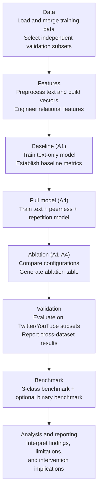

# F21RP | Research Project – Cyberbullying Detection & Intervention

---

## Title Page

**F21RP**  
1 | Research Project – Cyberbullying Detection & Intervention

**INTELLIGENT MODEL FOR CYBERBULLYING  
DETECTION AND INTERVENTION**

**RESEARCH REPORT – F21RP**  
MACS, HERIOT WATT  
RICCARTON, EDINBURGH

| Field | |
|-------|---|
| **Student name** | [Your Name] |
| **Course** | MSc Computer Science |
| **Project title** | Intelligent Model for Cyberbullying Detection and Intervention |
| **Supervisor** | [Supervisor Name] |
| **Co-Supervisor** | [Co-Supervisor Name] |
| **Date** | [Submission Date] |

*Submitted in partial fulfilment of the degree of MSc Computer Science, Heriot-Watt University.*

---

## ABSTRACT

This research report presents the design and evaluation of an intelligent cyberbullying detection model that integrates text-based classification with relational and behavioural features. Existing automated systems rely largely on lexical or NLP-based analysis of message content; a recognised shortcoming is the conflation of offensive language with hate speech and the absence of signals that capture who is involved and how often harm occurs. This study uses a publicly available dataset that provides message-level text together with peerness and repetition at the user-pair level. A multi-branch model (text plus tabular features) is trained on that dataset, evaluated on held-out data with stratified splits, and validated on independent Twitter and YouTube corpora to assess generalisation. Benchmarking against established hate-speech and offensive-language datasets, and optional comparison with OLID, supports comparison with prior work. Ablation experiments isolate the contribution of text-only, text-plus-peerness, text-plus-repetition, and full configurations. The report discusses implications for moderator support and repeat-offender identification, along with limitations and directions for future work.

*Word count (abstract): ~200*

---

## Quote (Optional)

> "Success is not final, failure is not fatal; It is the courage to continue that counts."  
> — Winston Churchill

---

## Acknowledgements

[Add your acknowledgements here.]

---

## TABLE OF CONTENTS

| Section | Page |
|---------|------|
| [Abstract](#abstract) | — |
| [Abbreviations](#abbreviations) | — |
| [Chapter 1: Introduction](#chapter-1-introduction) | — |
| [Chapter 2: Literature Review](#chapter-2-literature-review) | — |
| [Chapter 3: Requirement Analysis](#chapter-3-requirement-analysis) | — |
| [Chapter 4: Methodology](#chapter-4-methodology) | — |
| [Chapter 5: Professional, Legal, Ethical and Social Issues](#chapter-5-professional-legal-ethical-and-social-issues) | — |
| [Chapter 6: Project Plan](#chapter-6-project-plan) | — |
| [Chapter 7: Conclusion and Limitations](#chapter-7-conclusion-and-limitations) | — |
| [List of Figures](#list-of-figures) | — |
| [Bibliography](#bibliography) | — |

---

## List of Figures

| Figure | Title |
|--------|--------|
| 1 | Gantt chart (8-week project plan) |

*Additional figures (e.g., ablation results, confusion matrices) will be added when implementation is complete.*

---

## Abbreviations

| Abbreviation | Definition |
|--------------|------------|
| CBLabel | Cyberbullying label (binary) |
| ML | Machine Learning |
| NLP | Natural Language Processing |
| OLID | Offensive Language Identification Dataset |
| SVM | Support Vector Machine |
| TF-IDF | Term Frequency–Inverse Document Frequency |
| XGBoost | Extreme Gradient Boosting |

---

## Chapter 1  
## INTRODUCTION

### 1.1 Background and Motivation

Cyberbullying affects many young people online and is widely defined as repeated, targeted harm between peers, with intent to cause distress [1]. Unlike a single offensive message, cyberbullying involves patterns of behaviour: who is involved (peerness, a relational feature), how often messages occur (repetition, a behavioural feature), and the proportion of aggressive content. Text-only detection—relying on keywords, lexicons, or even advanced NLP—often fails because the same words can be harmless or harmful depending on context and intent [3]. Davidson et al. [3] showed that conflating offensive language with hate speech leads to poor precision; distinguishing severity matters for both detection and intervention. There is thus a need for models that combine text with relational and behavioural features.

From a practical perspective, harmful language detection in social platforms is challenging because abusive phenomena are heterogeneous, context-dependent, and sensitive to annotation choices and label definitions. Large-scale annotation studies highlight that “abuse” is not a single category and that systems must be evaluated carefully to avoid misleading conclusions about real-world performance [14]. Survey work on hate-speech detection similarly emphasises that label taxonomies, dataset bias, and evaluation choices can substantially influence reported results, reinforcing the need for robust metrics and leakage-aware validation [15]. These observations motivate the project’s emphasis on comparative evaluation (ablation) and cross-dataset testing rather than relying on a single in-sample accuracy figure.

In addition, cyberbullying is inherently linked to repeated interactions and relationship context, which are not captured by isolated message classification. This motivates incorporating relational and behavioural signals alongside text so that the model can support intervention-oriented questions such as which user pairs exhibit repeated aggression and which cases should be prioritised for moderation support [1, 7].

To address these limitations, this research adopts a holistic, multi-dimensional approach rather than relying on message text alone. The investigation combines linguistic, relational, and behavioural signals so that harmful interactions can be assessed in context, including who is involved, how often aggression occurs, and how severity may evolve over repeated exchanges. The implementation therefore uses derived indicators (e.g., aggression_ratio and combined_score) to identify higher-risk patterns and support intervention-oriented analysis. A critical methodological constraint is data overlap across commonly used corpora; to avoid leakage and inflated results, validation is conducted only on independent Twitter and YouTube subsets [2]. Because those subsets do not provide relational fields, evaluation there uses text-only or default values where required. Benchmarking further incorporates the Automated Hate Speech dataset [3, 4] and optionally OLID [5]. All data are publicly available, and no primary data collection is conducted.

### 1.2 Aim

The aim of this project is to design and evaluate an intelligent cyberbullying detection approach that goes beyond text-only classification by incorporating relational and behavioural dimensions, in order to improve detection quality and support intervention-oriented decision making.

### 1.3 Objectives

To achieve this aim, the project has five main objectives:

1. Develop a multi-dimensional detection model that integrates text-based NLP with relational and behavioural features.
2. Quantify the specific contribution of each feature through a structured ablation study: A1 (text-only), A2 (text+peerness), A3 (text+repetition), and A4 (full model).
3. Evaluate model generalisability on independent external data while strictly avoiding overlapping sources that could cause leakage.
4. Benchmark performance against established offensive-language and hate-speech classification corpora.
5. Assess practical intervention implications, focusing on how relational features support moderator decisions and repeat-offender identification.

### 1.4 Research Question

The main question the project addresses is:

*What contribution do relational and behavioural features (peerness, repetition) make to cyberbullying detection compared with text-only approaches?*

This is answered by training and evaluating four model variants (A1–A4), validating on Twitter and YouTube, and benchmarking on external datasets, as set out in the methodology (Chapter 4).

---

## Chapter 2  
## LITERATURE REVIEW

This chapter reviews the significance of automated cyberbullying detection, the main detection technologies and models (text-based, multi-modal, and NLP/feature engineering), intervention and prevention approaches, limitations of existing systems, and the datasets used in this research, followed by a critical assessment and recommendations. The review draws on references [1]–[15].

### 2.1 Significance of the Topic

The topic has serious psychological, social, and academic effects, especially for adolescents [1, 7]. Automated detection can support platform moderators, educators, and early intervention systems. Most existing systems rely heavily on text alone: keywords, lexicons, or NLP-based classifiers [6, 9, 13]. As noted in Chapter 1, incorporating relational and behavioural signals (peerness, repetition) aligns with how cyberbullying is characterised and can improve both detection accuracy and intervention-oriented applications (e.g., identifying repeat offenders, ranking severity). This research addresses a critical gap in both theoretical modelling and the practical deployment of moderation systems.

### 2.2 Detection Technologies and Models

**Text-based detection.** Gradient-boosting and deep-learning models are widely used for text classification. XGBoost (Extreme Gradient Boosting) is an ensemble method that combines many shallow decision trees in sequence, where each new tree corrects the previous errors; it is commonly chosen because it is fast, handles sparse TF-IDF features well, and often gives strong baseline performance. TF-IDF (term frequency-inverse document frequency) converts text into weighted numeric vectors by emphasizing informative terms and down-weighting very common words. Deep models such as CNNs learn local phrase patterns (e.g., n-gram-like cues), while recurrent architectures (LSTMs, RNNs) model order and longer context in sequences; hybrid variants (e.g., DEA-RNN) attempt to combine these strengths. Mandala [9] provides an illustrative end-to-end NLP pipeline for cyberbullying detection.

For evaluation, accuracy alone is insufficient in imbalanced data. **Precision** measures how many predicted positives are truly positive (important to reduce false accusations), while **recall** measures how many actual positives are detected (important to avoid missing harmful content). **F1-score** balances precision and recall. This is especially relevant to a central methodological issue: conflation of offensive language with hate speech. Multi-class separation generally improves precision over binary or lexicon-only baselines [3, 15]. Davidson et al. [3] address this by introducing a three-way taxonomy (hate speech, offensive language, neither) and a crowd-sourced labelled corpus; they show that treating every rude message as hate speech leads to poor precision and that distinguishing severity is necessary for both detection and intervention (e.g., warning vs. escalation). Their dataset, available on GitHub [4], is used in this research for benchmarking. Founta et al. [14] further show at scale that abusive-language phenomena are heterogeneous and require robust annotation and evaluation protocols. Wulczyn et al. [10] study personal attacks in Wikipedia talk pages at scale and emphasise the importance of data lineage for sound validation design.

Given these trade-offs, this project uses a pragmatic implementation path: a strong, interpretable text baseline (TF-IDF + XGBoost) and comparative evaluation using precision, recall, F1, confusion matrix, and related metrics before integrating additional relational features in the full model.

**Image and multi-modal detection.** Several works extend beyond text. Manju Sri et al. [6] combine a text branch (XGBoost with TF-IDF/embeddings) with InceptionV3 [11], a deep CNN architecture that factorises convolutions to improve computational efficiency while preserving strong visual feature extraction, for image analysis of offensive gestures, hate symbols, and explicit visual content. Jaiswal and Attri [8] propose a multi-modal TIVA framework (Text, Images, Video, Audio), where each modality contributes complementary evidence: text semantics, image cues, temporal video context, and audio/speech signals. Their framework integrates facial expressions, body language, speaker recognition, and voice features such as MFCC (mel-frequency cepstral coefficients), which are compact spectral descriptors commonly used to capture timbral characteristics in speech processing. This research focuses on text and relational features (peerness, repetition); the multi-modal literature informs possible future extensions.

**NLP and feature engineering.** Standard pipelines include lowercasing; URL and @mention removal; tokenisation (spaCy, NLTK, or whitespace-based split); optional stop-word removal and lemmatisation; and vectorisation via TF-IDF (e.g., scikit-learn TfidfVectorizer) or pre-trained embeddings (GloVe, Sentence-BERT) [9]. The Towards Comprehensive dataset [1] was designed to include four aspects: aggressive text, repetition, peerness, and intent to harm. Recommended derived features include aggression_ratio = AggressiveMsgs / TotalMsgs, is_repeat_offender = (TotalMsgs ≥ 2) ∧ (AggressiveMsgs ≥ 1), and combined_score = Peerness × aggression_ratio. This research implements an ensemble: a text branch (TF-IDF plus XGBoost, or alternatively a pre-trained transformer) and a tabular branch taking [Peerness, TotalMsgs, AggressiveMsgs, aggression_ratio] into a small MLP, with combined logits or weighted averaging for the final prediction. A text-only baseline (Model A1) supports ablation. Zampieri et al. [5] provide the OLID benchmark (SemEval-2019), with Level A labels (offensive vs. non-offensive) mappable to a binary target for cross-dataset comparison.

### 2.3 Intervention and Prevention

Detection is useful only if it leads to action. The literature describes several intervention mechanisms. Real-time monitoring with immediate alerts to moderators, parents, or educators allows timely response and can reduce escalation. Pre-send feedback—warning users before a message is posted and allowing self-correction—has been proposed to curb harmful content at the point of creation. Vinodha et al. [7] discuss machine learning for cyberbullying detection in virtual spaces and describe cognitive AI chatbots that provide theory-based, personalised support for victims; they target early adolescents (e.g., 8–16 years) at high risk. Manju Sri et al. [6] and Jaiswal and Attri [8] similarly emphasise real-time monitoring and multi-modal pipelines. Web-based tailored interventions (e.g., cognitive restructuring, coping strategies, safe internet use) and BullyBuster-style integration of AI with psychological models illustrate how detection can be coupled with prevention. Combining detection with intervention—for example, identifying repeat offenders or high-risk (User1, User2) pairs—is why this research emphasises peerness and repetition: not only to classify a single message but to support decisions about who needs attention. The derived feature combined_score (peerness × aggression_ratio) directly supports such intervention design (e.g., severity ranking for moderator queues). Proactive monitoring nevertheless raises ethical considerations regarding the balance between user privacy and platform safety, necessitating transparent and proportionate criteria for any automated intervention.

### 2.4 Limitations of Existing Systems

Limitations reported in the literature include: high computational cost and long training times for deep models; poor generalisation across platforms, languages, and domains when training and test distributions differ; difficulty capturing sarcasm, slang, code-switching, and evolving language, including the use of 'algospeak' or creative emoji combinations designed to bypass keyword-based filters; dependence on large, high-quality labelled datasets; static or non-personalised assessment tools; and lexicon-based methods that conflate hate speech and offensive language and yield high false-positive rates when severity is not distinguished [3]. Wulczyn et al. [10] discuss personal attacks in Wikipedia talk pages, the same data source underlying parts of the Cyberbullying Dataset; their work reinforces the importance of understanding data provenance. The Towards Comprehensive dataset [1] addresses part of this by including repetition and peerness so that models can use more than raw text. Furthermore, a significant limitation of advanced deep learning models is their 'black box' nature; the lack of interpretability makes it difficult for moderators to justify specific enforcement actions, such as distinguishing whether a flag was triggered by the text's toxicity or the user's history of repetition. This research builds on that and tests generalisation on Twitter and YouTube [2] to measure how much performance changes when the source platform differs. Validation must avoid data leakage: aggression, attack, and toxicity files must not be used for validation because they overlap with training data.

### 2.5 Datasets Used in This Research and Their Sources

| Dataset | Source | Use in Project |
|---------|--------|----------------|
| Towards Comprehensive [1] | Mendeley Data (DOI: 10.17632/wmx9jj2htd.1). ~15.6k messages, user pairs, peerness, TotalMsgs, AggressiveMsgs. Text from Wikipedia talk corpus. | Training (Phase 1). Merge Dataset.csv with Repetition.csv on (User1, User2). |
| Cyberbullying Dataset [2] | Kaggle (Shahane). twitter (17.8k), twitter_racism (14.4k), twitter_sexism (15.8k), youtube (3.5k); aggression/attack/toxicity overlap—exclude. | Validation (Phase 2): Twitter and YouTube only. No peerness/repetition; use zero-shot or default values. |
| Automated Hate Speech [3, 4] | Davidson et al., GitHub (labeled_data.csv). ~24.8k tweets; class 0=hate_speech, 1=offensive, 2=neither. | Benchmark (Phase 3). Text-only; compare vs TF-IDF+LogReg. |
| OLID [5] | SemEval-2019, GitHub. ~14k tweets; Level A: offensive vs non-offensive. | Optional benchmark (Phase 4). Map to binary. |

A significant challenge across these datasets is class imbalance, where 'non-bullying' instances far outnumber 'bullying' cases. For example, the YouTube subset in the Cyberbullying Dataset [2] is notably smaller than the Twitter subsets, and the Automated Hate Speech [3] labels are heavily skewed toward 'offensive' rather than 'hate speech.' To address this during training, the project will implement data-balancing techniques such as class-weighting in the loss function or synthetic oversampling (e.g., SMOTE) to ensure the model does not become biased toward the majority class.

### 2.6 Critical Assessment and Recommendations

**Critical assessment.** (i) Text-based detection benefits from models like XGBoost [6] and from clear separation of hate speech vs offensive language [3]; (ii) adding relational and behavioural information (as in Towards Comprehensive [1]) can support both detection and intervention; (iii) By strictly isolating the 'Towards Comprehensive' training set from the Twitter and YouTube validation sets, this study ensures that the reported generalisation metrics reflect real-world performance rather than algorithmic memorization; (iv) ablation studies (A1–A4) are the appropriate method to quantify the contribution of peerness and repetition.

**Recommendations for further action:**

1. Use only Twitter and YouTube subsets for validation; exclude aggression, attack, and toxicity files and document this exclusion.
2. Run ablation studies (A1 text-only, A2 text+peerness, A3 text+repetition, A4 full model) on Towards Comprehensive; report F1, precision, recall, ROC-AUC, confusion matrix; optionally McNemar's test for significance.
3. Align model design with intervention needs: combined_score, is_repeat_offender, and severity ranking support moderator decisions and repeat-offender identification.
4. Consider OLID [5] as an optional Phase 4 benchmark for additional cross-dataset evidence on independent Twitter data (Level A: offensive vs non-offensive).

### 2.7 Research Gap and Contribution Positioning

Across the reviewed literature, three recurring gaps are most relevant to this project: (1) many studies optimise text-only classification without modelling repeated interactions between user pairs; (2) evaluation is often reported on single-source data, making cross-platform generalisation unclear; and (3) intervention relevance (e.g., who should be prioritised for moderation) is frequently discussed conceptually but weakly operationalised in model features.

This research positions its contribution at the intersection of these gaps by combining text with relational/behavioural signals, enforcing leakage-aware validation on independent subsets, and evaluating intervention-oriented indicators (e.g., repeat-offender and severity-oriented features) through ablation and external benchmarking.

---

## Chapter 3  
## REQUIREMENT ANALYSIS

### 3.1 MoSCoW

Requirements are prioritised using the MoSCoW method (Must have, Should have, Could have, Won't have):

| Priority | Requirements | Rationale |
|----------|--------------|-----------|
| **Must have** | R1, R2, R3, R6 | Core deliverables: training model (text + peerness + repetition), ablation studies, validation on independent data. R6 ensures validation integrity (no data leakage). |
| **Should have** | R4 | Benchmarking on Automated Hate Speech and OLID is expected for comparison with existing work; supports research credibility. |
| **Could have** | R5 | Intervention discussion adds value but can be addressed qualitatively from ablation/validation results even without additional analysis. |
| **Won't have** | Multi-modal (image/audio) detection, real-time deployment, new data collection | Out of scope for this research report; documented as limitations. |

### 3.2 Functional Requirements

Requirements are derived from the aim and objectives (Sections 1.2 and 1.3) and are linked directly to the evaluation plan (Section 4.5) and Project Plan (Chapter 6).

| ID | Requirement | Source (Aim/Objective) | How evaluated |
|----|-------------|------------------------|----------------|
| R1 | The system shall build a detection model using text, peerness, and repetition from Towards Comprehensive. | Objective 1 | Training pipeline; model outputs on training/test split (Phase 1). |
| R2 | The system shall support ablation: text-only (A1), text+peerness (A2), text+repetition (A3), full model (A4). | Objective 2 | Ablation table (F1, precision, recall, etc.) on Towards Comprehensive. |
| R3 | The system shall be validated on independent Twitter and YouTube data (no aggression/attack/toxicity). | Objective 3 | Cross-dataset performance on Twitter and YouTube subsets; comparison with training performance. |
| R4 | The system shall be benchmarked on Automated Hate Speech (3-class) and optionally OLID (binary). | Objective 4 | Benchmark results table; comparison with baselines. |
| R5 | The system shall support discussion of intervention (repeat-offender, severity). | Objective 5 | Use of peerness/repetition in model; interpretation of ablation and validation for intervention. |
| R6 | Validation shall avoid data leakage: no use of aggression, attack, or toxicity files for validation. | Methodology | Validation limited to Twitter and YouTube subsets only. |

### 3.3 Non-Functional Requirements

Non-functional requirements are prioritised with the same MoSCoW scheme:

| Priority | Non-functional requirement | Rationale |
|----------|----------------------------|-----------|
| **Must have** | Reproducibility: code and data paths documented; stratified splits and no data leakage | Essential for validity of reported results. |
| **Must have** | Performance: model trainable on typical hardware; inference feasible for batch evaluation | Enables completion and benchmarking within project scope. |
| **Should have** | Interpretability: metrics (F1, precision, recall, confusion matrix) reported per experiment | Supports comparison and intervention discussion. |
| **Could have** | Extensibility: modular structure (data, features, models, evaluation) for future extension | Helps maintenance and optional additions (e.g. OLID). |
| **Won't have** | Real-time deployment, multi-modal pipelines, new data collection | Out of scope; documented as limitations. |

### 3.4 Traceability

These requirements are traceable to the evaluation metrics (accuracy, precision, recall, F1, ROC-AUC, confusion matrix), ablation experiments (A1–A4), and validation/benchmark phases described in the Methodology (Chapter 4) and Project Plan (Chapter 6).

---

## Chapter 4  
## METHODOLOGY

This chapter includes: (1) functional and non-functional requirements prioritised according to MoSCoW; (2) information about the datasets used; (3) the plan followed for implementation. It is linked to the detailed requirement analysis in Chapter 3 and to the project plan (Gantt chart, risks) in Chapter 6.

### 4.1 Requirements (MoSCoW)

Requirements are prioritised using the MoSCoW method. **Functional requirements** (R1–R6) are defined in Section 3.2; **non-functional requirements** (reproducibility, performance, interpretability, extensibility) are in Section 3.3. The following summary aligns both with MoSCoW:

| Priority | Scope | Rationale |
|----------|--------|-----------|
| **Must have** | R1, R2, R3, R6; reproducibility; no data leakage; trainable/evaluable on available hardware | Core deliverables and validity of results. |
| **Should have** | R4 (benchmarking); interpretability (metrics reported) | Research credibility and comparison with prior work. |
| **Could have** | R5 (intervention discussion); modular/extensible structure | Adds value without blocking completion. |
| **Won't have** | Multi-modal detection, real-time deployment, new data collection | Out of scope; documented as limitations. |

### 4.2 Data Collection

No primary data collection is carried out. The project uses existing, publicly available datasets published by other researchers (see Section 2.5 and references [1–5, 10]). The core training source is the Towards Comprehensive dataset [1], where message-level records are merged with relational records using (User1, User2) to attach peerness and repetition signals. For external validation, the Cyberbullying dataset [2] is used with independent Twitter and YouTube subsets only. For benchmarking, the Automated Hate Speech dataset [3, 4] is used as a 3-class task (hate speech, offensive language, neither), and OLID [5] is included as an optional binary benchmark.

This data design supports the methodological aim of evaluating both in-domain performance and out-of-domain generalisation. It also supports the intervention objective by enabling analysis of repeated aggression and user-pair dynamics where relational fields are available.

### 4.3 Datasets and Overlap

**Towards Comprehensive** and parts of the **Cyberbullying Dataset** share the same text source (Elsafoury / Wikipedia talk corpus). The aggression, attack, and toxicity files in the Cyberbullying Dataset contain the same underlying text as the training data; using them for validation would cause **data leakage** and overestimate generalisation.

**Evidence:** The same message (e.g., “Stop being an asshole and suggesting unwarranted punishments…”) appears in both Towards Comprehensive (`Dataset.csv`) and in the aggression, attack, and toxicity parsed datasets. The source chain is: Wikipedia Talk Corpus (Figshare) → Elsafoury “Cyberbullying datasets” (Mendeley) → Towards Comprehensive and the aggression/attack/toxicity files.

**Implications:**

| File in Cyberbullying Dataset | Overlap with Towards Comprehensive? | Use for validation? |
|------------------------------|-------------------------------------|----------------------|
| aggression_parsed_dataset.csv | Yes (same Wikipedia text) | **No** |
| attack_parsed_dataset.csv    | Yes (same Wikipedia text) | **No** |
| toxicity_parsed_dataset.csv   | Yes (same Wikipedia text) | **No** |
| twitter_parsed_dataset.csv    | No (different platform)   | **Yes** |
| twitter_racism_parsed_dataset.csv | No | **Yes** |
| twitter_sexism_parsed_dataset.csv | No | **Yes** |
| youtube_parsed_dataset.csv    | No (different platform)   | **Yes** |
| kaggle_parsed_dataset.csv     | Check (may contain Wikipedia text) | Verify before use |

Validation therefore uses **only Twitter and YouTube** subsets, so that reported performance reflects generalisation to independent data rather than text shared with the training set.

**Summary of datasets used:**

| Phase | Dataset | Purpose |
|-------|---------|---------|
| Training | Towards Comprehensive [1] | Text, peerness, repetition; merge Dataset.csv + Repetition.csv on (User1, User2). |
| Validation | Cyberbullying [2] (Twitter, YouTube only) | Cross-platform generalisation; text-only or default values for peerness/repetition. |
| Benchmark | Automated Hate Speech [3, 4] | 3-class (hate, offensive, neither). |
| Optional benchmark | OLID [5] | Binary (Level A); independent Twitter. |

A significant challenge across these datasets is class imbalance, where non-bullying instances outnumber bullying instances. For example, the YouTube subset in the Cyberbullying dataset [2] is smaller than the Twitter subsets, and labels in Automated Hate Speech [3, 4] are skewed toward offensive language relative to hate speech. To reduce majority-class bias, training uses stratified splits and should include balancing strategies such as class-weighting and, where appropriate, synthetic oversampling (e.g., SMOTE), with performance reported using precision, recall, F1, and confusion matrices rather than accuracy alone.

### 4.4 Model Design

The primary model combines:

- **Text features:** TF-IDF or pre-trained embeddings (e.g., Sentence-BERT [12], model hub: https://huggingface.co/sentence-transformers) from the message content.
- **Peerness:** A score (0–1) indicating the likelihood that two users are peers.
- **Repetition:** Total messages and aggressive messages between user pairs; derived `aggression_ratio` = AggressiveMsgs / TotalMsgs.

Training is performed on merged Towards Comprehensive data (main dataset joined with repetition file on User1, User2). A stratified train/test split (e.g., 80/20) is used, ensuring that the same (User1, User2) pair does not appear in both train and test. Model options include an ensemble (text branch, e.g. TF-IDF/XGBoost, plus tabular branch for peerness and repetition) or a hybrid neural architecture. A text-only baseline supports ablation.

### 4.5 Evaluation Plan (Linked to Requirements)

- **Ablation studies (R2):** Four controlled configurations are evaluated on the same split protocol: A1 text only; A2 text + peerness; A3 text + repetition; A4 full model (text + peerness + repetition). The purpose is to isolate the marginal contribution of each feature group rather than only reporting best-case performance. Results are reported in a single comparison table so performance gains/losses are directly interpretable.

- **Metrics and interpretation:**  
  - **Accuracy:** overall proportion of correct predictions; useful as a high-level measure but can be misleading under class imbalance.  
  - **Precision:** among predicted bullying cases, the proportion that are truly bullying; high precision reduces false alarms.  
  - **Recall:** among true bullying cases, the proportion correctly detected; high recall reduces missed harmful cases.  
  - **F1-score:** harmonic mean of precision and recall; the primary summary metric when class distribution is skewed.  
  - **ROC-AUC:** threshold-independent discrimination quality for binary settings.  
  - **Confusion matrix:** counts of TP/TN/FP/FN; used to analyse error types and intervention risk (false positives vs false negatives).  
  Metrics are reported per experiment; where relevant, both per-class and macro-averaged values are included.

- **Validation (R3, R6):** Validation uses only independent Twitter and YouTube subsets. Because relational fields are unavailable there, validation follows two complementary strategies: (1) **text-only pathway** (directly evaluating the text branch) and (2) **default-value pathway** (fixed/median values for missing peerness/repetition) to test robustness of the full architecture under missing relational inputs. Performance is reported per subset and as an aggregate summary, then compared against in-domain training/test performance to quantify domain shift. The same preprocessing and metric definitions are used across training and validation for comparability.

- **Benchmarking (R4):**  
  - **Automated Hate Speech:** 3-class task (hate speech, offensive language, neither). Report accuracy, macro precision/recall/F1, and class-wise scores to avoid majority-class bias.  
  - **OLID (optional):** binary offensive vs non-offensive (Level A mapping). Report binary precision, recall, F1, ROC-AUC, and confusion matrix.  
  Benchmarking is used to position results against established corpora and to test transferability beyond the primary training setup.

Where appropriate, paired model comparisons are additionally assessed with McNemar's test to check whether observed differences are statistically significant.

A drop in validation performance relative to in-domain training/test results is expected and methodologically valid when training and validation come from different platforms and annotation contexts (e.g., Wikipedia-derived vs Twitter/YouTube). This drop is interpreted as evidence of domain shift, not necessarily model failure, and is analysed using the metric breakdown above.

### 4.6 Implementation Plan

The implementation follows a phased plan aligned with the requirements and evaluation plan:

1. **Data:** Load and merge Towards Comprehensive data; explore and document structure; select validation subsets (Twitter and YouTube only; exclude aggression, attack, toxicity).
2. **Features:** Text preprocessing (lowercase, URL/mention removal, tokenisation); vectorisation (TF-IDF or embeddings); derived features (aggression_ratio, combined_score, is_repeat_offender).
3. **Baseline (A1):** Text-only model (e.g. TF-IDF + XGBoost); stratified train/test split; establish baseline metrics.
4. **Full model (A4):** Ensemble or hybrid (text + peerness + repetition); train and evaluate.
5. **Ablation (A2, A3, A4):** Run A1–A4; produce ablation table (F1, precision, recall, ROC-AUC, confusion matrix).
6. **Validation:** Evaluate on Twitter and YouTube subsets; report cross-dataset performance.
7. **Benchmark:** Automated Hate Speech (3-class); optionally OLID (binary).
8. **Analysis and reporting:** Interpret results; discuss generalisation, intervention, limitations; finalise report and figures.

*Figure: Implementation workflow from data preparation to reporting.*

A week-by-week Gantt chart and risk analysis are given in Chapter 6 (Project Plan).

### 4.7 Ethics and Data Protection

All data are secondary and publicly available. No surveys or social media scraping are conducted. Data are stored in a secured environment (e.g., OneDrive); originals are preserved and not modified; any preprocessing is applied to working copies only.

### 4.8 Methodological Quality Controls

To improve validity and reproducibility, the following controls are applied throughout implementation and evaluation:

- **Leakage control:** keep overlapping sources out of validation and ensure the same (User1, User2) pair does not appear across train/test splits.  
- **Preprocessing consistency:** apply identical tokenisation/vectorisation logic across ablation, validation, and benchmark runs.  
- **Imbalance-aware reporting:** prioritise precision, recall, F1, confusion matrix, and macro metrics over accuracy-only comparisons.  
- **Comparative fairness:** use the same split protocol and metric set for A1–A4 so feature-level contributions are attributable.  
- **Result traceability:** store model outputs, confusion matrices, and experiment settings per run for transparent comparison and write-up.

---

## Chapter 5  
## PROFESSIONAL, LEGAL, ETHICAL AND SOCIAL ISSUES

### 5.1 Professional

- **Reproducibility:** The use of public datasets (Mendeley, Kaggle, GitHub), a clear validation strategy (Twitter and YouTube only), and a phase-based implementation (training, validation, benchmark) supports reproducibility. Code and data sources should be cited and, where possible, shared.
- **Standards:** Following standard ML practice (stratified splits, no leakage, ablation studies) and reporting metrics (F1, precision, recall) aligns with norms in NLP and social computing.
- **Limitations:** The report should clearly state that the model is trained on Wikipedia-derived and synthetic user structure; generalisation to other platforms and languages is limited and should be discussed.

### 5.2 Legal

- **Data use:** All datasets used are publicly available and used in accordance with their stated terms (Mendeley, Kaggle, GitHub). No personal data are collected; no scraping of live social media is performed.
- **Intellectual property:** Any code or outputs produced for the project should respect university and programme policies on IP and use of third-party resources.

### 5.3 Ethical

- **Bias and fairness:** Automated detection can perpetuate bias (e.g., over-flagging certain groups or dialects). The report should discuss this and, where possible, consider fairness metrics or subgroup analysis in evaluation.
- **Dual use:** Detection technology could be misused (e.g., surveillance). The project is framed for positive intervention (moderation, support); this intent should be stated.
- **Transparency:** Use of generative AI tools (if any) must be declared as per programme guidelines (e.g., in an appendix).

### 5.4 Data Protection

All data are secondary and publicly available. No surveys or social media scraping are conducted. Data are stored in a secured environment (e.g., OneDrive); originals are preserved and not modified; any preprocessing is applied to working copies only.

### 5.5 Social

- **Impact on users:** Deployed systems could affect freedom of expression and user trust. Recommendations (e.g., human-in-the-loop moderation, explainability) are relevant.
- **Stakeholders:** Educators, platform moderators, and mental health support services are key stakeholders; the discussion of intervention (repeat-offender, severity) connects the technical work to social benefit.

---

## Chapter 6  
## PROJECT PLAN

### 6.1 Task Analysis

Tasks are derived from the methodology and aligned with the implementation phases:

1. **Data:** Load and merge Towards Comprehensive data; explore and document structure; implement validation subset selection restricted to Twitter and YouTube (excluding aggression, attack, and toxicity files).
2. **Features:** Text preprocessing (lowercase, URL/mention handling, tokenisation); vectorisation (TF-IDF or embeddings); peerness and repetition feature engineering (aggression_ratio, etc.).
3. **Baseline:** Implement text-only model (e.g., TF-IDF + XGBoost); establish baseline metrics.
4. **Full model:** Implement ensemble or hybrid (text + peerness + repetition); train and evaluate.
5. **Ablation:** Run A1–A4; produce ablation table and interpretation.
6. **Validation:** Evaluate on Twitter and YouTube subsets; report cross-dataset performance.
7. **Benchmark:** Evaluate on Automated Hate Speech (3-class) and, if used, OLID (binary).
8. **Analysis and writing:** Interpret results; discuss generalisation, intervention, limitations; finalise report and figures.

### 6.2 Gantt Chart (8-Week Plan)

| Task | Week 1 | Week 2 | Week 3 | Week 4 | Week 5 | Week 6 | Week 7 | Week 8 |
|------|:------:|:------:|:------:|:------:|:------:|:------:|:------:|:------:|
| Load, merge, explore Towards Comprehensive | ■ | | | | | | | |
| Feature engineering, text preprocessing | | ■ | | | | | | |
| Implement baseline (text-only) | | | ■ | | | | | |
| Implement full model (text + peerness + repetition) | | | | ■ | | | | |
| Run ablation studies (A1–A4) | | | | | ■ | | | |
| Validation on Cyberbullying (Twitter, YouTube) | | | | | | ■ | | |
| Benchmark (Automated Hate Speech; optional OLID) | | | | | | | ■ | |
| Analysis, writing, visualisation | | | | | | | | ■ |

*Figure 1: Gantt chart (overview). Detailed Gantt can be produced with project management software.*

### 6.3 Risk Analysis and Mitigation

| Risk | Likelihood | Impact | Mitigation |
|------|------------|--------|------------|
| Data leakage between training and validation | Medium | High | Use only Twitter and YouTube subsets for validation; exclude aggression, attack, and toxicity files. Document exclusion. |
| Class imbalance affecting metrics | High | Medium | Use stratified splits; consider class weights or oversampling (e.g. SMOTE); report precision, recall, F1, and confusion matrix. |
| Hardware or runtime constraints | Low | Medium | Use efficient models (e.g. TF-IDF + XGBoost); optional embeddings; batch evaluation. |
| Scope creep (e.g. multi-modal, real-time) | Medium | Medium | Keep scope to text + peerness + repetition; document out-of-scope items as limitations. |
| Delays in implementation or writing | Medium | Medium | Follow phased plan; prioritise Must-have requirements; use Gantt to track progress. |

---

## Chapter 7  
## CONCLUSION AND LIMITATIONS

### 7.1 Conclusion

This report has presented the design of an intelligent cyberbullying detection and intervention-oriented model. The research question—*What contribution do relational and behavioural features (peerness, repetition) make to cyberbullying detection compared with text-only approaches?*—is addressed through a methodology that trains on the Towards Comprehensive dataset (text, peerness, repetition), validates on independent Twitter and YouTube data only, and benchmarks on Automated Hate Speech and optionally OLID.

Key methodological choices include: (1) using only Twitter and YouTube subsets for validation to avoid data leakage from overlapping Wikipedia-sourced files; (2) running ablation studies to quantify the contribution of peerness and repetition; and (3) aligning the model design with intervention needs (e.g., repeat-offender and severity indicators). The restriction of validation to Twitter and YouTube subsets and the documented implementation phases support reproducibility and clarity of the research design.

### 7.2 Limitations

- **Scope:** The project focuses on text and relational features; multi-modal (image, audio) detection is not implemented.
- **Data:** Training data are from Wikipedia talk pages; behaviour and language on other platforms may differ; domain shift is expected on Twitter/YouTube validation.
- **Validation data:** Twitter and YouTube subsets do not contain peerness or repetition; evaluation uses defaults or text-only evaluation where appropriate, which may underestimate the benefit of the full model when relational features are available in deployment.
- **Ethics and deployment:** Broader ethical and privacy considerations (e.g., fairness, transparency, human-in-the-loop) are relevant for future work and real-world deployment.

---

## Bibliography

The report is based on at least 10 references, with more than 50% from published sources (books, journals, conference/workshop proceedings). Internet sources are attributed; Wikipedia is not used as a primary reference.

[1] N. Ejaz, S. Choudhury, and F. Razi, “Towards Comprehensive Cyberbullying Detection: A Dataset Incorporating Aggressive Texts, Repetition, Peerness, and Intent to Harm,” Mendeley Data, v1, 2023. DOI: 10.17632/wmx9jj2htd.1.

[2] S. Shahane, “Cyberbullying Dataset,” Kaggle, 2023. [Online]. Available: https://www.kaggle.com/datasets/saurabhshahane/cyberbullying-dataset

[3] T. Davidson, D. Warmsley, M. Macy, and I. Weber, “Automated Hate Speech Detection and the Problem of Offensive Language,” in Proc. 11th International AAAI Conference on Web and Social Media (ICWSM), 2017, pp. 512–515.

[4] T. Davidson, “Hate Speech and Offensive Language,” GitHub, 2017. [Online]. Available: https://github.com/t-davidson/hate-speech-and-offensive-language

[5] M. Zampieri et al., “Predicting the Type and Target of Offensive Posts in Social Media,” in Proc. NAACL-HLT, 2019, pp. 1415–1420.

[6] S. Manju Sri et al., “Cyberbullying Detection and Prevention Using AI,” International Journal of Advanced Research in Science, Engineering and Technology (IJARSET), vol. 12, no. 4, 2025.

[7] D. Vinodha, E. A. Mary Anita, J. Jenefa, and M. Lapina, “Machine Learning Approaches for Detection of Cyberbullying in Virtual Space,” in DET-2024: International Conference on Distance Education Technologies, LNNS, vol. 1616, Springer, 2025, pp. 104–111. DOI: 10.1007/978-3-032-04365-8_9

[8] T. Jaiswal and V. K. Attri, “A Proposed Multi-modal Approach to Detect Cyberbullying in Multi File Format—An Empirical Study,” in Smart Systems and Wireless Communication (SSWC 2024), SIST, vol. 433, Springer, 2025, pp. 541–557. DOI: 10.1007/978-981-96-1348-9_40

[9] S. Mandala, “Cyberbullying Detection - NLP,” Kaggle, 2022. [Online]. Available: https://www.kaggle.com/code/sujithmandala/cyberbullying-detection-nlp/input

[10] E. Wulczyn, N. Thain, and L. Dixon, “Ex Machina: Personal Attacks Seen at Scale,” in Proc. 26th International Conference on World Wide Web (WWW), 2017, pp. 1391–1399.

[11] C. Szegedy, V. Vanhoucke, S. Ioffe, J. Shlens, and Z. Wojna, “Rethinking the Inception Architecture for Computer Vision,” in Proc. IEEE Conference on Computer Vision and Pattern Recognition (CVPR), 2016, pp. 2818–2826.

[12] N. Reimers and I. Gurevych, “Sentence-BERT: Sentence Embeddings using Siamese BERT-Networks,” in Proc. 2019 Conference on Empirical Methods in Natural Language Processing (EMNLP-IJCNLP), 2019, pp. 3982–3992.

[13] C. Van Hee et al., “Automatic detection of cyberbullying in social media text,” PLOS ONE, vol. 13, no. 10, e0203794, 2018.

[14] A.-M. Founta, C. Djouvas, D. Chatzakou, I. Leontiadis, J. Blackburn, G. Stringhini, A. Vakali, M. Sirivianos, and N. Kourtellis, “Large Scale Crowdsourcing and Characterization of Twitter Abusive Behavior,” in Proc. 12th International AAAI Conference on Web and Social Media (ICWSM), 2018, pp. 491–500.

[15] P. Fortuna and S. Nunes, “A Survey on Automatic Detection of Hate Speech in Text,” ACM Computing Surveys, vol. 51, no. 4, article 85, 2018.

---

**Supporting project documents (internal):**

- *docs/guides/dissertation-key-factors-from-papers.md* — Summary of detection technologies, intervention, limitations, datasets, and practical approach table.
- *docs/guides/additional-datasets-for-validation.md* — OLID recommendation and other benchmark options.

---

*Report length: approximately 25 pages (ACM-style formatting). Quality is prioritised over length. All sources are attributed; no unattributed cut-and-paste.*
